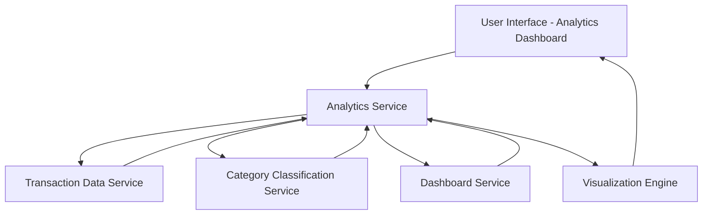

#### 1. High-Level Design

- **Summary:** This epic delivers interactive visualizations and analytics capabilities providing users with deep insights into spending patterns across multiple categories (Food & Dining, Fuel, Shopping, Travel, Entertainment, Utilities, Healthcare, Education, Miscellaneous). It offers monthly spend trends and card-wise spend analysis through intuitive charts and graphs, enabling users to identify patterns and make informed financial decisions.

- **Component Flow:**

- **Integration Points:**
  - **Upstream:** Transaction data service (provides raw spending data), Category classification service (categorizes transactions), Dashboard service (provides consolidated spend metrics)
  - **Downstream:** Serves analytical insights to the user interface with no downstream system dependencies mentioned

- **Key Assumptions:**
  - Transactions are pre-categorized by the Category Classification Service or categorized on-demand; Monthly aggregations are pre-computed or cached for performance optimization.

- **NFR Highlights:** Analytics visualizations must render within 1 second; System must support interactive filtering and drill-down capabilities; Charts must be responsive and adapt to different screen sizes.

#### 2. Validation Report

- **Requirements Coverage:** The design fully addresses all scope requirements including category-wise spending visualization, monthly spend trends, card-wise spend analysis, interactive charts and graphs, spending pattern identification, and multi-category analytics across all specified categories. The architecture incorporates a dedicated Visualization Engine to meet the 1-second rendering NFR and supports interactive filtering through the Analytics Service layer. The integration with Transaction Data Service, Category Classification Service, and Dashboard Service ensures comprehensive data availability for all analytical views. The responsive design requirement is addressed through the Visualization Engine's adaptive rendering capabilities.