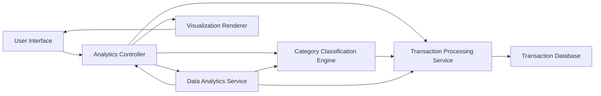

#### 1. High-Level Design

- **Summary:** This epic provides interactive visualizations and analytics capabilities to help users understand spending patterns across nine categories (Food & Dining, Fuel, Shopping, Travel, Entertainment, Utilities, Healthcare, Education, Miscellaneous). The feature includes monthly spend trend analysis and interactive charts that enable users to identify overspending areas and optimize budget management.

- **Component Flow:**

- **Integration Points:** 
  - **Upstream:** Transaction Processing Service (for raw transaction data), Category Classification Engine (for transaction categorization), Data Analytics Service (for trend calculation and aggregation)
  - **Downstream:** Visualization Renderer (for chart generation), User Interface (for interactive analytics display)

- **Key Assumptions:** 
  - Category classification assumes either pre-categorized transaction data or a machine learning-based classifier with reasonable accuracy (>85%)
  - Monthly spend trends assume calendar month boundaries for aggregation unless user specifies custom date ranges

- **NFR Highlights:** Analytics must process and display data for minimum 12 months of transaction history, visualization rendering must complete within 3 seconds, support interactive filtering and drill-down capabilities, maintain data accuracy across all calculations

- **Data Flow:** User initiates analytics view through the user interface, analytics controller requests transaction data from the transaction processing service, which retrieves historical transactions from the transaction database. Transactions are passed to the category classification engine for categorization into nine predefined categories. The data analytics service aggregates categorized transactions, calculates monthly spend trends, and generates statistical insights. Processed analytics data is sent to the visualization renderer, which creates interactive charts and graphs (category breakdowns, trend lines, spending patterns). The rendered visualizations are displayed in the user interface with interactive filtering and drill-down capabilities, allowing users to explore spending details by category, time period, and transaction level.

#### 2. Validation Report

- **Requirements Coverage:** The design fully covers the epic's stated scope including category-wise spending visualization, monthly spend trends analysis, interactive charts and graphs, spending pattern identification, all nine category breakdowns (Food & Dining, Fuel, Shopping, Travel, Entertainment, Utilities, Healthcare, Education, Miscellaneous), and transaction history view. All NFRs are addressed: the architecture supports 12+ months of transaction history through the transaction database, 3-second visualization rendering is achievable through optimized data analytics service and caching, interactive filtering and drill-down are enabled through the visualization renderer component, and data accuracy is maintained through the transaction processing service and data analytics service validation layers. All dependencies (transaction processing service, category classification engine, data analytics service) are integrated into the component flow. The design excludes out-of-scope items (real bank integration, payments, fund transfers, loans, payment gateway).