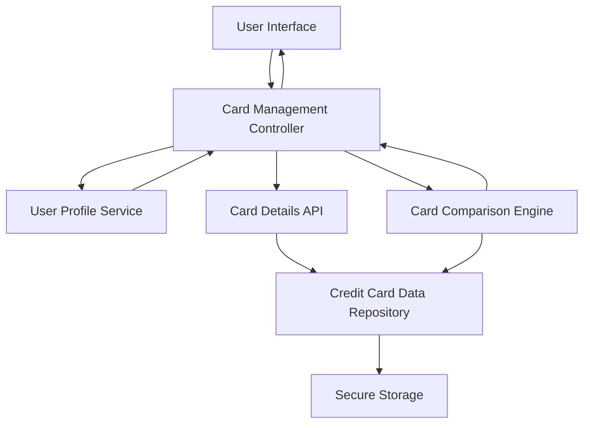

#### 1. High-Level Design

- **Summary:** This epic enables users to manage and monitor multiple credit cards from a single consolidated interface. Users can view all cards with individual details, track card-specific spending patterns, analyze performance across cards, and manage card addition/removal, eliminating the need to switch between multiple banking apps or websites.

- **Component Flow:**

- **Integration Points:** 
  - **Upstream:** User Profile Service (for card ownership validation), Card Details API (for retrieving card-specific information), Credit Card Data Repository (for card data storage and retrieval)
  - **Downstream:** User Interface (for multi-card display and interaction), Card Comparison Engine (for cross-card analysis)

- **Key Assumptions:** 
  - Card addition assumes users will manually input card details or link via a simplified non-bank integration method (e.g., manual entry, CSV upload)
  - Card-wise spend analysis assumes transaction data is already categorized and associated with specific card identifiers in the data repository

- **NFR Highlights:** System must support minimum 10 credit cards per user, card data must be securely stored and encrypted, interface must maintain performance with increasing number of cards, responsive design for all screen sizes

- **Data Flow:** User accesses the multi-card interface through the card management controller, which validates card ownership via the user profile service. The controller retrieves individual card details from the card details API, which queries the credit card data repository. Card-specific information (credit limits, balances, spending patterns) is fetched from secure storage and presented in a consolidated view. When users compare cards, the card comparison engine aggregates data across multiple cards and returns comparative metrics. Card addition/removal operations update the user profile service and credit card data repository, with all sensitive data encrypted in secure storage.

#### 2. Validation Report

- **Requirements Coverage:** The design comprehensively addresses the epic's scope including multiple card display, card-wise spend analysis, individual card details view, card comparison capabilities, card addition/removal interface, and card-specific credit limit and balance tracking. All NFRs are satisfied: the architecture supports 10+ cards per user through scalable data repository design, secure storage with encryption ensures data security, performance is maintained through efficient data retrieval and caching strategies, and responsive design is implemented at the UI layer. All dependencies (credit card data repository, user profile service, card details API) are integrated. The design respects out-of-scope boundaries (no real bank integration, payments, fund transfers, loans, payment gateway).