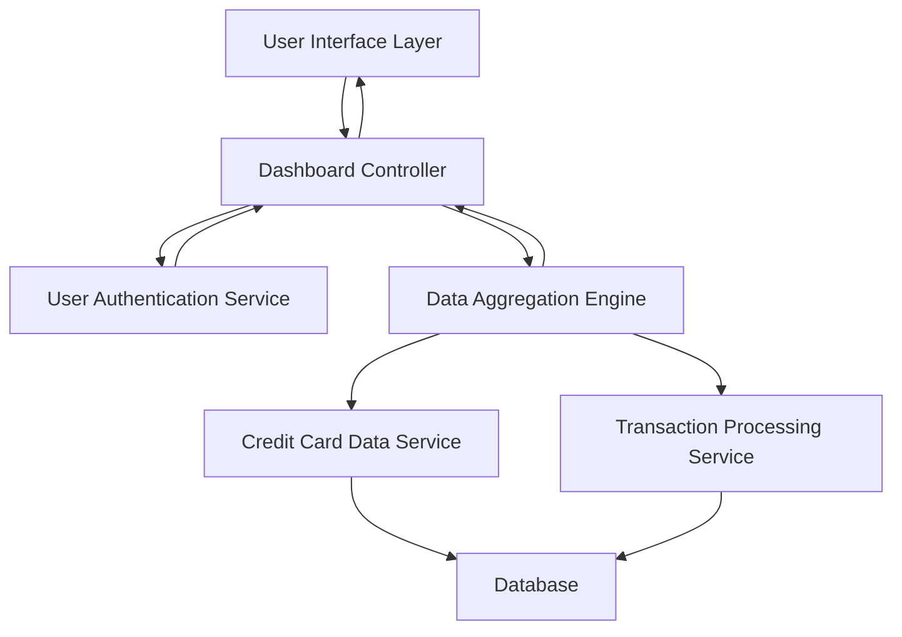

#### 1. High-Level Design

- **Summary:** This epic delivers a comprehensive financial overview dashboard displaying key performance indicators for credit card management. The dashboard provides real-time visibility into monthly spend, total credit limit, available credit, and outstanding amounts across all user credit cards, enabling informed financial decisions and credit utilization management.

- **Component Flow:**

- **Integration Points:** 
  - **Upstream:** User Authentication Service (for secure access), Credit Card Data Service (for card information retrieval), Transaction Processing Service (for monthly spend and outstanding amount calculations)
  - **Downstream:** User Interface Layer (web/mobile clients), Dashboard rendering components

- **Key Assumptions:** 
  - Real-time data synchronization assumes near-real-time batch updates (e.g., every 5-15 minutes) rather than true real-time streaming
  - KPI calculations assume standardized data formats from upstream services with consistent field mappings

- **NFR Highlights:** Dashboard must load within 2 seconds, support responsive design for mobile and desktop, handle concurrent users viewing multiple cards, ensure data accuracy and real-time synchronization

- **Data Flow:** User authenticates through the authentication service, dashboard controller requests aggregated KPI data from the data aggregation engine, which queries the credit card data service for card details (credit limits, available credit) and transaction processing service for spend and outstanding amounts. Aggregated metrics are calculated and returned to the dashboard controller, which formats and presents monthly spend, total credit limit, available credit, and outstanding amounts to the user interface in real-time.

#### 2. Validation Report

- **Requirements Coverage:** The design fully covers the epic's stated scope including monthly spend display, total credit limit calculation, available credit tracking, outstanding amount monitoring, responsive dashboard layout, and real-time KPI updates. All NFRs are addressed through the architecture: 2-second load time is achievable through data aggregation engine caching, responsive design is handled at the UI layer, concurrent user support is managed through scalable service architecture, and data accuracy is ensured through transaction processing service validation. All dependencies (credit card data service, transaction processing service, user authentication service) are integrated into the component flow. The design explicitly excludes out-of-scope items (real bank integration, payments, fund transfers, loans, payment gateway).