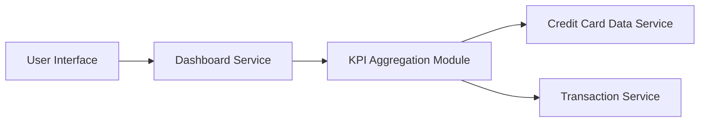

#### 1. High-Level Design

- **Summary:** This epic delivers a comprehensive dashboard that consolidates key performance indicators (KPIs) for credit card portfolio management. Users can monitor monthly spend, total credit limit, available credit, and outstanding amounts in real-time through a responsive interface that works across mobile and desktop devices.

- **Component Flow:**

- **Integration Points:**
  - **Upstream:** Credit Card Data Service (for card balances and limits), Transaction Service (for monthly spend calculations)
  - **Downstream:** User Interface (web/mobile responsive dashboard)

- **Key Assumptions:**
  - Real-time data updates occur via polling or event-driven mechanisms at regular intervals (not specified)
  - KPI calculations are performed server-side with cached results to meet 2-second load time requirement

- **NFR Highlights:** Dashboard must load within 2 seconds, support responsive design for mobile and desktop devices, handle real-time data updates

#### 2. Validation Report

- **Requirements Coverage:** The design fully covers the epic's stated scope including monthly spend display, credit limit calculation, available credit tracking, outstanding amount monitoring, responsive layout, and KPI visualization. The component flow addresses integration with required services (Credit Card Data Service and Transaction Service) and ensures KPI aggregation can meet the 2-second load time constraint through proper caching and optimization strategies.