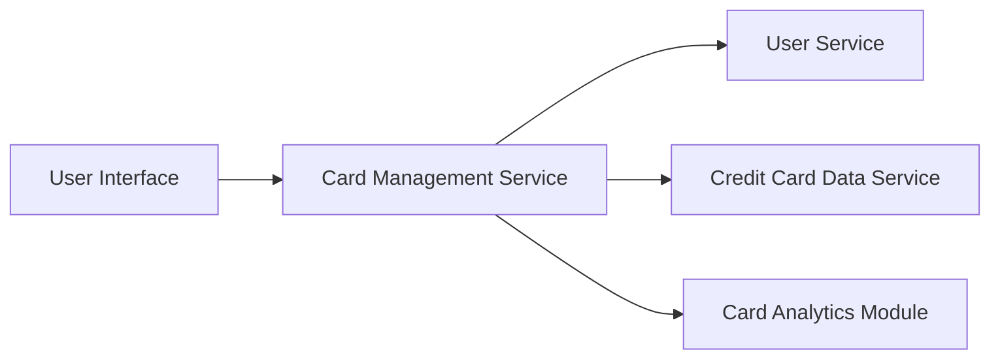

#### 1. High-Level Design

- **Summary:** This epic enables users to manage and monitor multiple credit cards (up to 50 per user) from a unified interface. Users can view all cards, access card-specific details, perform card-wise spend analysis, and compare performance across different cards, eliminating the need to access multiple platforms.

- **Component Flow:**

- **Integration Points:**
  - **Upstream:** Credit Card Data Service (for card information and balances), User Service (for authentication and card ownership validation)
  - **Downstream:** User Interface (card listing, filtering, and comparison views)

- **Key Assumptions:**
  - Card ownership validation is performed on each request to ensure security and data isolation
  - Card data is retrieved with pagination or lazy loading to handle up to 50 cards efficiently within 300ms latency

- **NFR Highlights:** System must support viewing and managing up to 50 credit cards per user, card data retrieval latency must be under 300ms

#### 2. Validation Report

- **Requirements Coverage:** The design addresses all scope elements including multiple credit card display, card-wise spend analysis, card details viewing, card selection and filtering, and card comparison capabilities. The architecture ensures integration with User Service for authentication and Credit Card Data Service for card data, with performance optimization to meet the 300ms latency requirement for up to 50 cards per user.