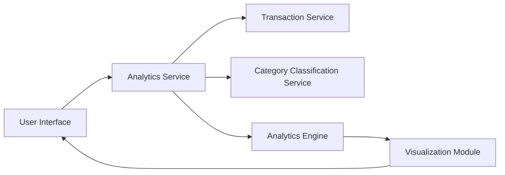

#### 1. High-Level Design

- **Summary:** This epic provides interactive visualizations and analytics for understanding spending patterns across nine predefined categories (Food & Dining, Fuel, Shopping, Travel, Entertainment, Utilities, Healthcare, Education, Miscellaneous). Users can analyze category-wise spending and monthly trends over at least 12 months of historical data to make informed financial decisions.

- **Component Flow:**

- **Integration Points:**
  - **Upstream:** Transaction Service (for transaction data), Category Classification Service (for transaction categorization), Analytics Engine (for data aggregation and visualization processing)
  - **Downstream:** User Interface (interactive charts, graphs, and spending pattern visualizations)

- **Key Assumptions:**
  - Transaction categorization is pre-processed and stored to avoid real-time classification overhead during analytics queries
  - Historical data aggregation is pre-computed for common time ranges to meet 1-second query execution requirement

- **NFR Highlights:** Analytics queries must execute within 1 second, support interactive visualizations with smooth rendering, handle historical data for at least 12 months

#### 2. Validation Report

- **Requirements Coverage:** The design comprehensively covers all scope requirements including category-wise spending visualization, monthly spend trends, interactive charts and graphs, spending pattern analysis, and category breakdown for all nine specified categories. The architecture integrates with Transaction Service, Category Classification Service, and Analytics Engine to deliver actionable insights while meeting the 1-second query execution and 12-month historical data retention requirements.