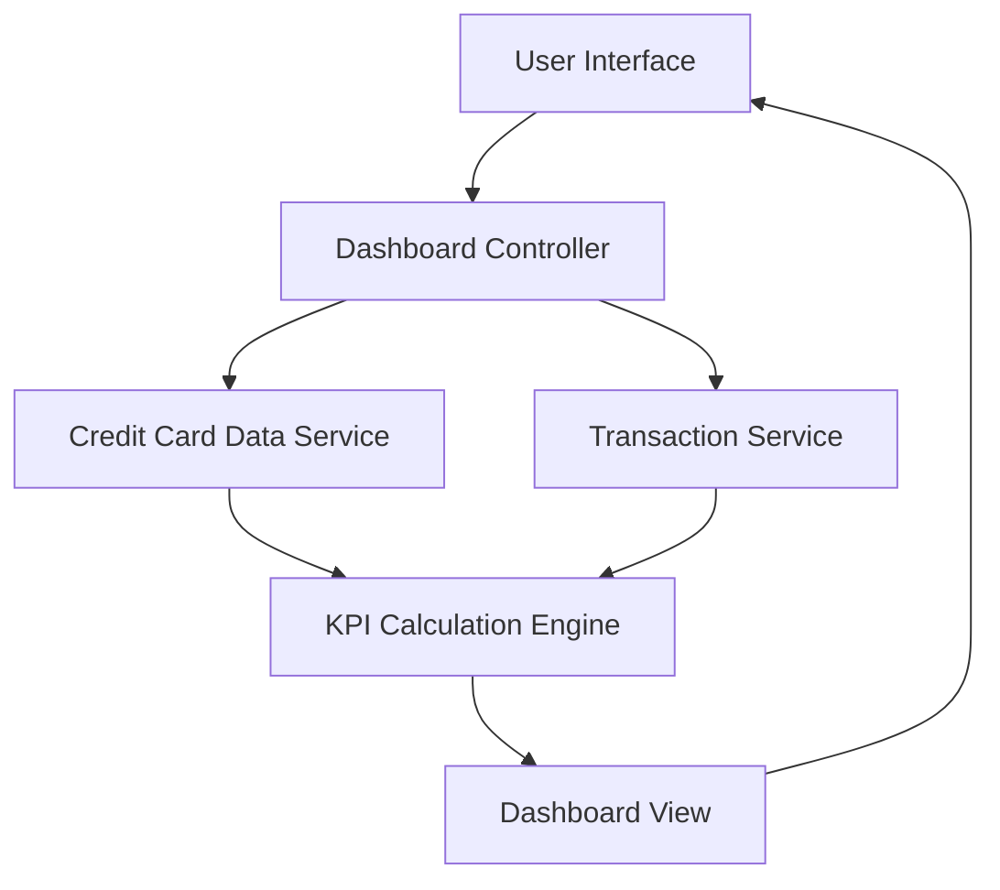

#### 1. High-Level Design

- **Summary**: This epic provides a consolidated dashboard displaying key performance indicators (KPIs) for the user's entire credit card portfolio. The dashboard shows monthly spend, total credit limit, available credit, and outstanding amount in a responsive, real-time interface. It offers instant visibility into overall credit card financial health and credit utilization across all cards.

- **Component Flow**:

- **Integration Points**: 
  - **Upstream**: Credit Card Data Service (retrieves card balances, credit limits, and available credit)
  - **Upstream**: Transaction Service (calculates monthly spend and outstanding amounts)
  - **Downstream**: User Interface (renders consolidated KPI dashboard)

- **Key Assumptions**: 
  - Credit Card Data Service and Transaction Service provide aggregated data; KPI calculations are performed in real-time or cached with near-real-time refresh.
  - "Monthly spend" refers to current calendar month; outstanding amount includes all unpaid balances across all cards.

- **NFR Highlights**: Dashboard must load within 2 seconds; System must support responsive design across desktop, tablet, and mobile devices; Data refresh rate should be near real-time.

- **Data Flow**: User accesses dashboard → Dashboard Controller fetches card data from Credit Card Data Service and transaction data from Transaction Service → KPI Calculation Engine aggregates data to compute monthly spend, total credit limit, available credit, and outstanding amount → Calculated KPIs are formatted and sent to Dashboard View → Responsive dashboard is rendered to User Interface with real-time or near-real-time data → Dashboard auto-refreshes to maintain data currency.

#### 2. Validation Report

- **Requirements Coverage**: The design fully satisfies the epic's scope including monthly spend display, total credit limit calculation, available credit tracking, outstanding amount visualization, responsive dashboard layout, and consolidated KPI view. The architecture addresses all NFRs: 2-second load time, responsive design across all device types, and near-real-time data refresh. Integration dependencies with Credit Card Data Service and Transaction Service are clearly defined and support the required KPI calculations. The consolidated view aligns with the user value of providing instant financial health visibility without navigating multiple screens.