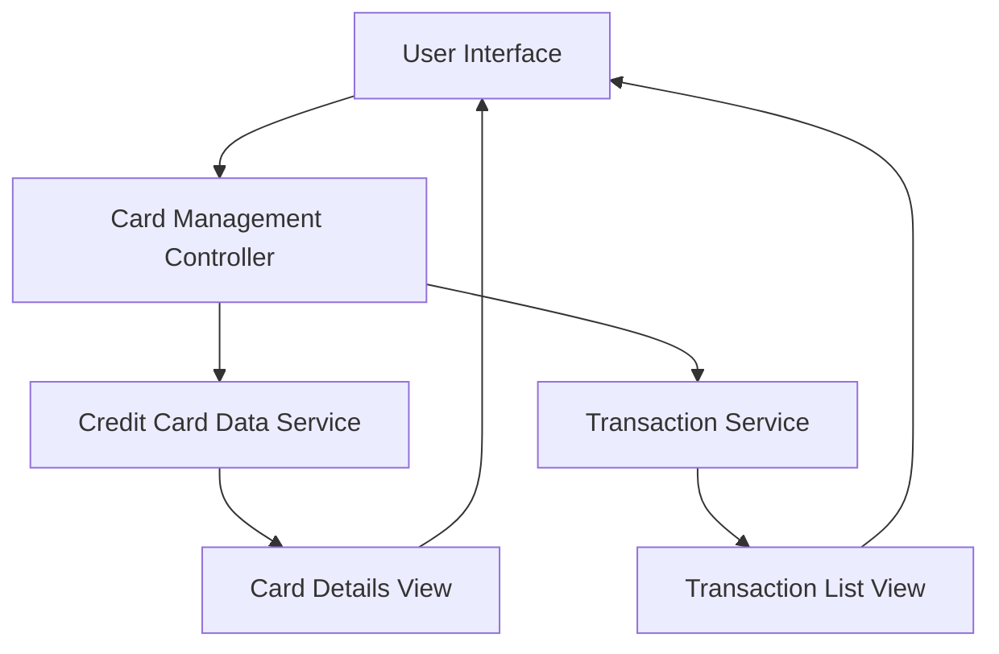

#### 1. High-Level Design

- **Summary**: This epic enables users to manage and monitor multiple credit cards (up to 10 per user) from a unified interface. Users can view all cards with individual details, perform card-wise spend analysis, and track transactions for each card separately. The feature consolidates credit card portfolio management into a single access point.

- **Component Flow**:

- **Integration Points**: 
  - **Upstream**: Credit Card Data Service (provides card information including balances, limits, and card metadata)
  - **Upstream**: Transaction Service (provides card-specific transaction history)
  - **Downstream**: User Interface (displays card list, details, and transactions)

- **Key Assumptions**: 
  - Credit Card Data Service maintains up-to-date card information with real-time or near-real-time synchronization.
  - Each card has a unique identifier that links transactions in the Transaction Service to specific cards.

- **NFR Highlights**: System must support at least 10 credit cards per user; Card data retrieval must complete within 1 second; Interface must maintain performance with up to 1000 transactions per card.

- **Data Flow**: User accesses card management interface → Card Management Controller retrieves all user cards from Credit Card Data Service → Card list is displayed with summary information → User selects a specific card → Controller fetches detailed card information from Credit Card Data Service and transaction history from Transaction Service → Card details and transaction list are rendered → User can filter, sort, and analyze card-wise spending.

#### 2. Validation Report

- **Requirements Coverage**: The design comprehensively addresses the epic's scope including multiple credit card display, card-wise spend analysis, individual card details view, transaction listing per card, and card selection/filtering. The architecture supports the NFR requirements for 10+ cards per user, 1-second data retrieval, and performance with 1000+ transactions per card. Integration points with Credit Card Data Service and Transaction Service are properly defined. The unified interface approach aligns with the user value of consolidating portfolio management.