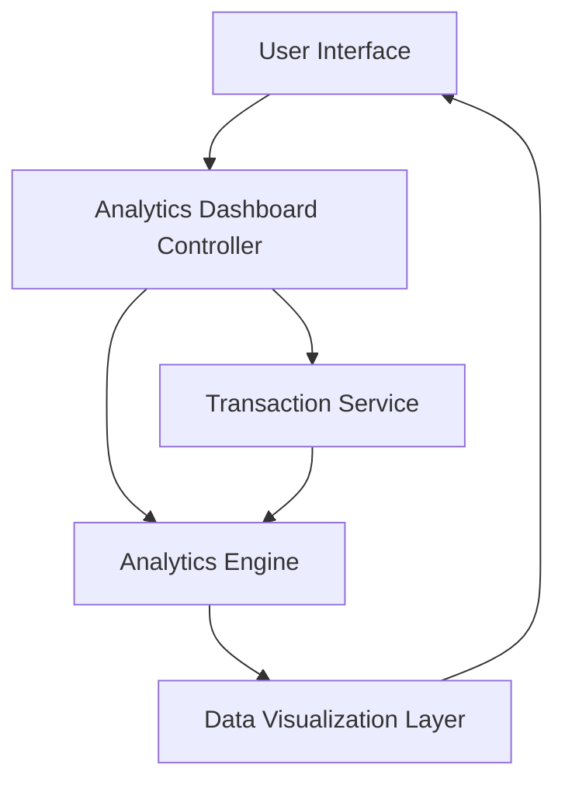

#### 1. High-Level Design

- **Summary**: This epic delivers an interactive analytics dashboard that visualizes credit card spending patterns across nine predefined categories (Food & Dining, Fuel, Shopping, Travel, Entertainment, Utilities, Healthcare, Education, Miscellaneous). It provides monthly trend analysis to help users understand spending behavior over time and make informed financial decisions.

- **Component Flow**:

- **Integration Points**: 
  - **Upstream**: Transaction Service (provides transaction data and categorization)
  - **Upstream**: Analytics Engine (processes and aggregates spending data by category and time period)
  - **Downstream**: User Interface (renders visualizations and interactive charts)

- **Key Assumptions**: 
  - Transaction categorization is performed by the Transaction Service and categories are pre-assigned; user cannot manually re-categorize transactions.
  - Historical data is available for at least 12 months in the Transaction Service with consistent data quality.

- **NFR Highlights**: Analytics visualizations must render within 3 seconds; System must handle 12+ months of historical data; Charts must be interactive with drill-down; Responsive across all device types.

- **Data Flow**: User requests analytics view → Analytics Dashboard Controller fetches transaction data from Transaction Service → Data is sent to Analytics Engine for aggregation by category and time period → Aggregated results are formatted by Data Visualization Layer → Interactive charts and trend graphs are rendered to User Interface → User can drill down into specific categories or time periods.

#### 2. Validation Report

- **Requirements Coverage**: The design fully covers the epic's scope including category-wise spending visualization, monthly trend charts, interactive analytics dashboard, spending pattern identification, multi-category analysis, and trend comparison. All nine predefined categories are supported. The architecture addresses the NFRs for 3-second rendering, 12-month historical data handling, interactivity, and responsive design. Integration dependencies with Transaction Service and Analytics Engine are clearly identified and incorporated.