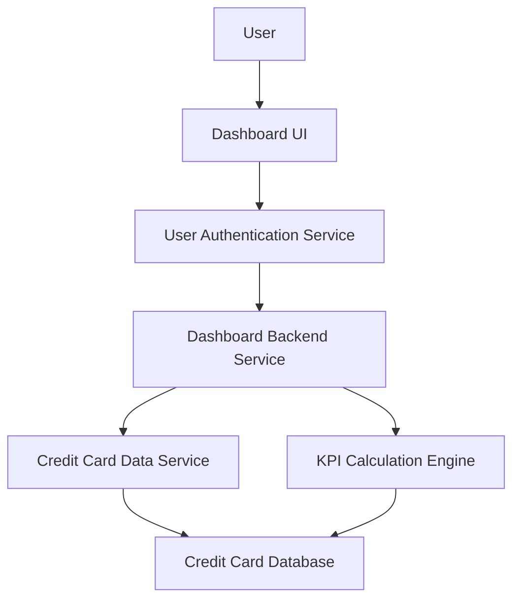

#### 1. High-Level Design

- **Summary:** This epic delivers a consolidated dashboard displaying key performance indicators for the user's credit card portfolio, including monthly spend, total credit limit, available credit, and outstanding amounts across all cards. The dashboard provides real-time visibility with sub-2-second load times and responsive design across all device types.

- **Component Flow:**

- **Integration Points:**
  - **Upstream:** Credit card data service for retrieving card details, balances, and transaction summaries
  - **Upstream:** User authentication service for secure access and user identity verification
  - **Downstream:** Credit Card Database for storing and retrieving card portfolio data

- **Key Assumptions:**
  - KPI calculations (available credit, outstanding amounts, monthly spend) are performed in real-time or near-real-time with cached aggregates
  - Multi-card data is normalized and aggregated at the service layer to ensure consistent display format

- **NFR Highlights:** Dashboard load time must be under 2 seconds; responsive design across desktop, tablet, and mobile devices; real-time data refresh capability required

- **Data Flow:** User logs in → User Authentication Service validates credentials → Dashboard UI requests KPI data → Dashboard Backend Service queries Credit Card Data Service for all user's cards → KPI Calculation Engine computes aggregated metrics (total credit limit, available credit, outstanding amounts, monthly spend) → Aggregated KPIs are returned to Dashboard UI → Dashboard displays consolidated view with real-time refresh capability → User monitors financial health and credit utilization across all cards

#### 2. Validation Report

- **Requirements Coverage:** The design fully addresses the epic's scope including dashboard KPIs display, monthly spend tracking, credit limit aggregation, available credit calculation, outstanding amount display, multiple credit card management, and responsive layout. All NFRs (responsive design across devices, sub-2-second load time, real-time refresh) are incorporated through optimized architecture and caching strategies. Integration dependencies (credit card data service, user authentication service) are properly integrated. Out-of-scope items (real bank integration, payments, transfers, loans, payment gateway) are excluded as specified.