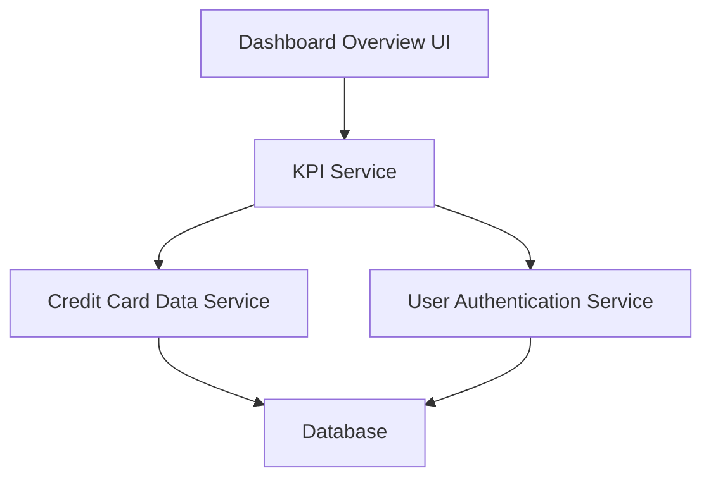

#### 1. High-Level Design

- **Summary:** This epic enables users to view a consolidated dashboard displaying key performance indicators for their credit card portfolio, including monthly spend, total credit limit, available credit, and outstanding amounts across all cards from a single, modern, responsive interface with real-time visibility.

- **Component Flow:**

- **Integration Points:** 
  - **Upstream:** Credit Card Data Service (for retrieving card details and balances), User Authentication Service (for secure access)
  - **Downstream:** Database (for card and balance data)

- **Key Assumptions:** 
  - KPI calculations (total credit limit, available credit, outstanding amounts) are performed in real-time or near-real-time based on current database state.
  - Monthly spend is aggregated from transaction data for the current calendar month.

- **NFR Highlights:** System must support responsive design across desktop, tablet, and mobile devices; dashboard load time must be under 2 seconds; real-time data refresh capability.

- **Data Flow:** User authenticates and accesses dashboard → User Authentication Service validates credentials → KPI Service retrieves card details and balances from Credit Card Data Service → Database provides current card data → KPI Service calculates aggregated metrics (monthly spend, total credit limit, available credit, outstanding amounts) → Dashboard Overview UI renders consolidated view within 2-second load time with real-time refresh capability.

#### 2. Validation Report

- **Requirements Coverage:** The design fully addresses dashboard KPIs display, monthly spend tracking, total credit limit aggregation, available credit calculation, outstanding amount display, multiple credit card management, and responsive layout design. The architecture meets NFR requirements for responsive design across devices, sub-2-second load time, and real-time data refresh. Dependencies on Credit Card Data Service and User Authentication Service are properly integrated.