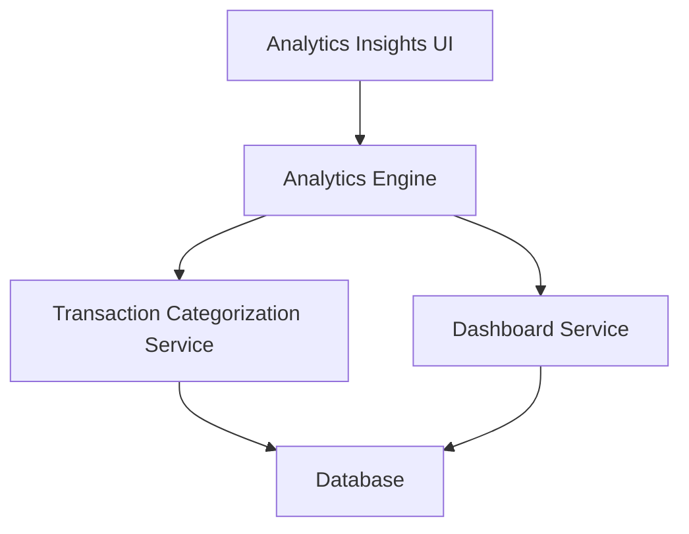

#### 1. High-Level Design

- **Summary:** This epic delivers interactive data visualizations and analytics capabilities for understanding spending patterns across predefined categories (Food & Dining, Fuel, Shopping, Travel, Entertainment, Utilities, Healthcare, Education, Miscellaneous), including monthly spend trend analysis and card-wise spend breakdowns for financial optimization.

- **Component Flow:**

- **Integration Points:** 
  - **Upstream:** Transaction Categorization Service (for category assignment), Analytics Engine (for data aggregation and trend calculation), Dashboard Service (for visualization rendering)
  - **Downstream:** Database (for transaction and categorization data)

- **Key Assumptions:** 
  - Category assignment is automated and consistent across all transactions.
  - Spend comparison across time periods uses standardized time intervals (e.g., monthly, quarterly).

- **NFR Highlights:** Analytics visualizations must load within 3 seconds; system must support interactive filtering and drill-down capabilities; charts must be responsive and mobile-friendly.

- **Data Flow:** User accesses analytics insights → Analytics Engine requests categorized transaction data from Transaction Categorization Service → Analytics Engine aggregates data by category, time period, and card → Dashboard Service generates interactive visualizations → Analytics Insights UI renders responsive charts within 3-second load time with filtering and drill-down capabilities.

#### 2. Validation Report

- **Requirements Coverage:** The design comprehensively covers category-wise spending visualization, monthly spend trend analysis, card-wise spend analysis, interactive charts and graphs, spending pattern identification, multi-category breakdown, and spend comparison across time periods. The architecture meets NFR requirements for 3-second load time, interactive filtering/drill-down, and responsive mobile-friendly charts. All dependencies (Transaction Categorization Service, Analytics Engine, Dashboard Service) are integrated.