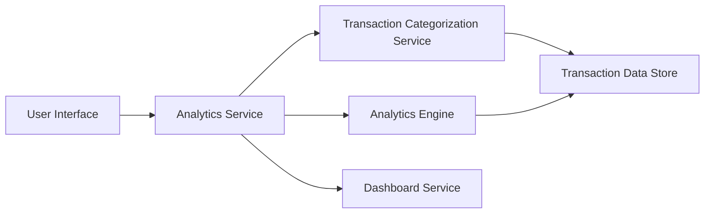

#### 1. High-Level Design

- **Summary:** This epic provides interactive data visualizations and analytics for understanding spending patterns across predefined categories (Food & Dining, Fuel, Shopping, Travel, Entertainment, Utilities, Healthcare, Education, Miscellaneous). It includes monthly trend analysis, card-wise spend breakdowns, and time-period comparisons to enable financial optimization insights.

- **Component Flow:**

- **Integration Points:**
  - **Upstream:** Transaction categorization service for automatic category assignment to transactions
  - **Upstream:** Analytics engine for data aggregation, trend calculation, and pattern identification
  - **Upstream:** Dashboard service for rendering interactive visualizations and charts

- **Key Assumptions:**
  - Transactions are automatically categorized into the 9 predefined categories using rule-based or ML-based categorization logic
  - Analytics data is pre-aggregated at daily/monthly intervals to ensure sub-3-second visualization load times

- **NFR Highlights:** Analytics visualizations must load within 3 seconds; interactive filtering and drill-down capabilities required; charts must be responsive and mobile-friendly

- **Data Flow:** User accesses analytics dashboard → Analytics Service retrieves categorized transaction data from Transaction Categorization Service → Analytics Engine processes and aggregates data by category, time period, and card → Aggregated insights are passed to Dashboard Service → Interactive charts (category breakdown, monthly trends, card-wise analysis) are rendered in UI → User interacts with visualizations through filtering and drill-down capabilities

#### 2. Validation Report

- **Requirements Coverage:** The design comprehensively addresses all scope elements including category-wise visualization, monthly trend analysis, card-wise analysis, interactive charts, pattern identification, multi-category breakdown, and time-period comparison. All NFRs (3-second load time, interactive filtering, responsive charts) are supported through pre-aggregation and optimized rendering. Integration dependencies (categorization service, analytics engine, dashboard service) are properly incorporated. Out-of-scope items (predictive forecasts, budget alerts, external integrations, tax reporting) are excluded as specified.