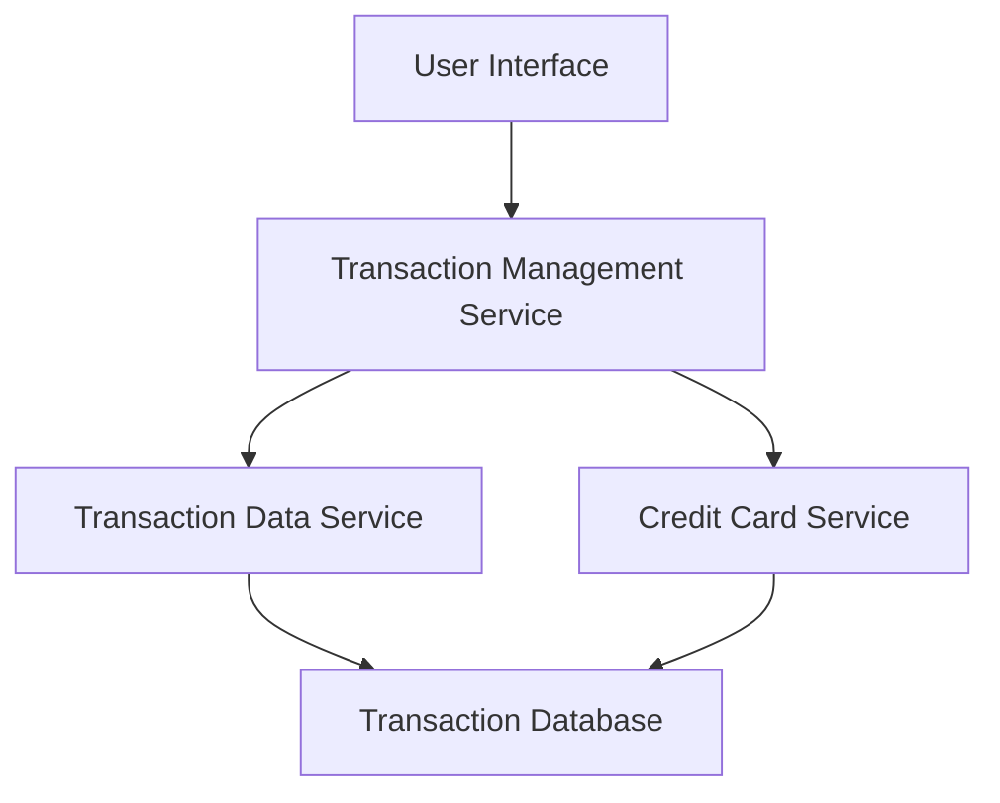

#### 1. High-Level Design

- **Summary:** This epic delivers comprehensive transaction viewing capabilities enabling users to access, search, and monitor detailed transaction history across all their credit cards for up to 12 months. The feature supports multi-card transaction aggregation with pagination for performance optimization and responsive display across devices.

- **Component Flow:**

- **Integration Points:** 
  - **Upstream:** Transaction data service for retrieving transaction records
  - **Upstream:** Credit card service for card-specific transaction filtering
  - **Downstream:** Transaction Database for historical transaction storage

- **Key Assumptions:** 
  - Transaction data is pre-categorized and stored in a queryable format with indexed fields for efficient search and filtering
  - User authentication and authorization are handled by an external authentication service before accessing transaction data

- **NFR Highlights:** System must handle 12 months of transaction history with pagination support; responsive format required for all device types; performance-optimized rendering for large transaction lists

- **Data Flow:** User requests transaction data through UI → Transaction Management Service authenticates request → Service queries Transaction Data Service and Credit Card Service to retrieve and filter transactions → Data is aggregated, paginated, and returned to UI → User views transaction list with detail drill-down capability, search, and filtering options

#### 2. Validation Report

- **Requirements Coverage:** The design fully covers the epic's stated scope including transaction listing, detail view, multi-card aggregation, search/filtering, and history access. All NFRs (12-month history, pagination, responsive format) are addressed through the architecture. Integration dependencies with Transaction Data Service and Credit Card Service are incorporated. Out-of-scope items (real bank integration, payments, transfers, disputes) are explicitly excluded from the design.