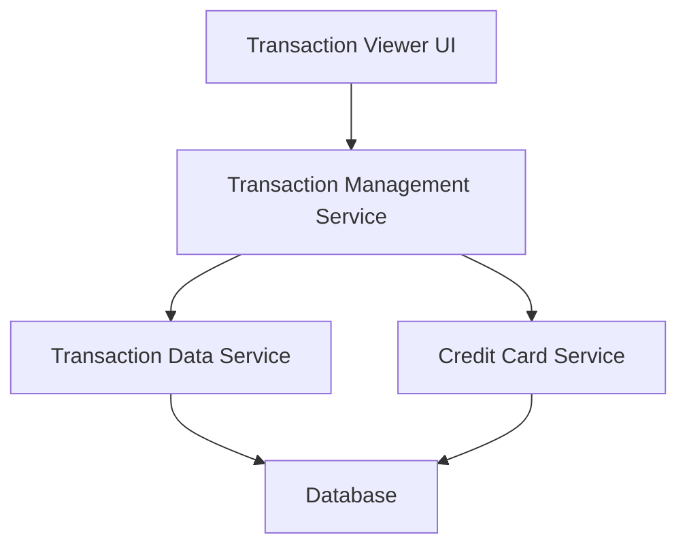

#### 1. High-Level Design

- **Summary:** This epic provides comprehensive transaction viewing capabilities across all credit cards, enabling users to access detailed transaction history, view transaction details, and monitor spending activity at a granular level for improved financial awareness and fraud detection.

- **Component Flow:**

- **Integration Points:** 
  - **Upstream:** Transaction Data Service (for retrieving transaction records), Credit Card Service (for card-specific transaction filtering)
  - **Downstream:** Database (for transaction history storage and retrieval)

- **Key Assumptions:** 
  - Transaction data is stored with sufficient metadata (timestamp, merchant, amount, card ID) to enable search and filtering.
  - Pagination is implemented to handle large transaction volumes efficiently.

- **NFR Highlights:** System must handle transaction history for up to 12 months; transaction list rendering must support pagination for performance; data must be displayed in a responsive format.

- **Data Flow:** User requests transaction history → Transaction Management Service queries Transaction Data Service for transaction records → Credit Card Service provides card-specific filtering context → Database returns paginated transaction data for up to 12 months → Transaction Viewer UI renders transaction list with search/filter capabilities in responsive format.

#### 2. Validation Report

- **Requirements Coverage:** The design fully addresses transaction listing, transaction detail view, multi-card transaction aggregation, transaction search and filtering, and transaction history access. The architecture supports NFR requirements for 12-month history, pagination for performance, and responsive display. Dependencies on Transaction Data Service and Credit Card Service are properly integrated.