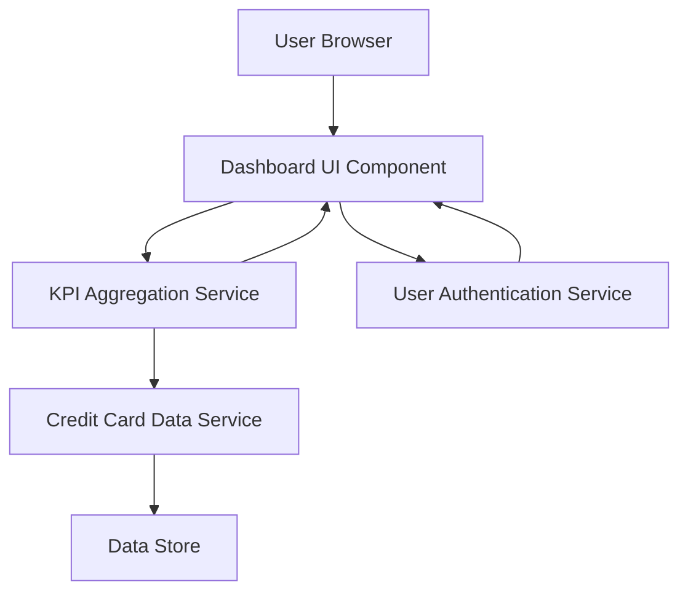

#### 1. High-Level Design

- **Summary:** This epic delivers a modern, responsive Credit Card Analysis Dashboard that provides users with a consolidated view of all credit cards and key performance indicators (KPIs) including monthly spend, total credit limit, available credit, and outstanding amounts. The dashboard serves as the primary entry point for users to gain quick insights into their overall credit card portfolio health and financial status.

- **Component Flow:**

- **Integration Points:**
  - **Upstream:** User Authentication Service (for secure user access and session management)
  - **Downstream:** Credit Card Data Service (for retrieving card information, limits, balances, and outstanding amounts)

- **Key Assumptions:**
  - Credit card data is pre-aggregated or can be computed on-demand within the 2-second load time constraint.
  - User authentication is handled by an existing service with standard OAuth2/JWT token-based authentication.

- **NFR Highlights:** Dashboard must load within 2 seconds; must support responsive design across desktop, tablet, and mobile devices; must comply with WCAG 2.1 accessibility standards.

#### 2. Validation Report

- **Requirements Coverage:** The design covers all stated scope items including dashboard interface development, KPI display (monthly spend, total credit limit, available credit, outstanding amount), multiple credit card view, and responsive layout. The component flow demonstrates how user authentication, data retrieval, and KPI aggregation work together to deliver the dashboard experience within the specified 2-second load time. Integration points with authentication and credit card data services are clearly identified and align with the dependencies stated in the epic.