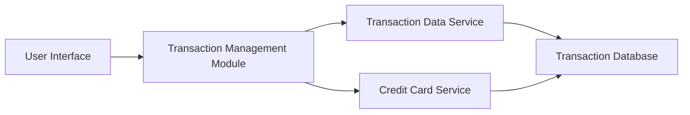

#### 1. High-Level Design

- **Summary:** This epic implements comprehensive transaction management capabilities enabling users to view, track, and analyze all credit card transactions across their portfolio. Users can access detailed transaction histories for each credit card, monitor spending activities, verify charges, and maintain accurate financial records. The transaction system provides foundational data for analytics and spending insights.

- **Component Flow:**

- **Integration Points:**
  - **Upstream:** Transaction Data Service (for retrieving transaction records with up to 12 months of history)
  - **Upstream:** Credit Card Service (for card-transaction mapping and card-wise transaction segregation)

- **Key Assumptions:**
  - Transaction data is indexed by card ID and timestamp to support sub-1-second query performance.
  - Transaction filtering is performed server-side with pagination support for large result sets.

- **NFR Highlights:** Transaction queries must return results within 1 second; must handle transaction history for up to 12 months; data integrity must be maintained with 99.9% accuracy.

#### 2. Validation Report

- **Requirements Coverage:** The design addresses all scope elements including transaction listing and display, transaction history per card, transaction details view, transaction filtering, and card-wise transaction segregation. The component flow demonstrates the interaction between the UI, transaction management module, and backend services to deliver sub-1-second query performance. Integration with transaction data service and credit card service aligns with stated dependencies. The architecture supports the NFR requirement of handling 12 months of transaction history with 99.9% data integrity.