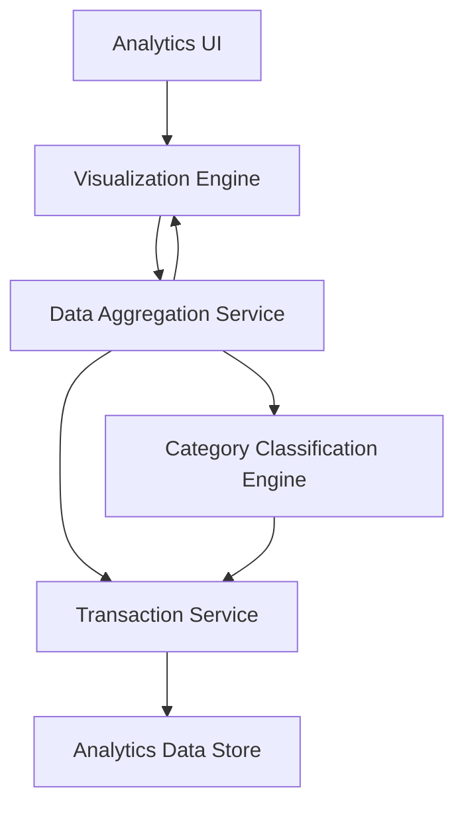

#### 1. High-Level Design

- **Summary:** This epic delivers advanced analytics and visualization capabilities providing users with actionable insights into spending behaviors and patterns. The system offers interactive visualizations including monthly spend trends and category-wise spending breakdowns across nine categories (Food & Dining, Fuel, Shopping, Travel, Entertainment, Utilities, Healthcare, Education, Miscellaneous), plus card-wise spend analysis for data-driven financial decisions.

- **Component Flow:**

- **Integration Points:**
  - **Upstream:** Transaction Service (for raw transaction data to be analyzed and visualized)
  - **Upstream:** Category Classification Engine (for transaction categorization into nine spending categories)
  - **Upstream:** Data Aggregation Service (for computing spending metrics and trends)

- **Key Assumptions:**
  - Category classification is either pre-computed at transaction ingestion time or cached to meet the 3-second rendering requirement.
  - Real-time data aggregation for up to 10,000 transactions is supported through optimized queries and in-memory caching.

- **NFR Highlights:** Analytics visualizations must render within 3 seconds; must support real-time data aggregation for up to 10,000 transactions; charts must be interactive and responsive across all device types.

#### 2. Validation Report

- **Requirements Coverage:** The design comprehensively covers all scope items including category-wise spending visualization, monthly spend trend analysis, card-wise spend analysis, interactive charts, nine spending category classification, spending pattern identification, and data aggregation/reporting. The component flow illustrates how transaction data flows through the category classification engine and data aggregation service to produce visualizations within the 3-second rendering constraint. All three stated dependencies (transaction service, category classification engine, data aggregation service) are incorporated into the architecture. The design supports the NFR of handling 10,000 transactions with interactive, responsive charts across all device types.