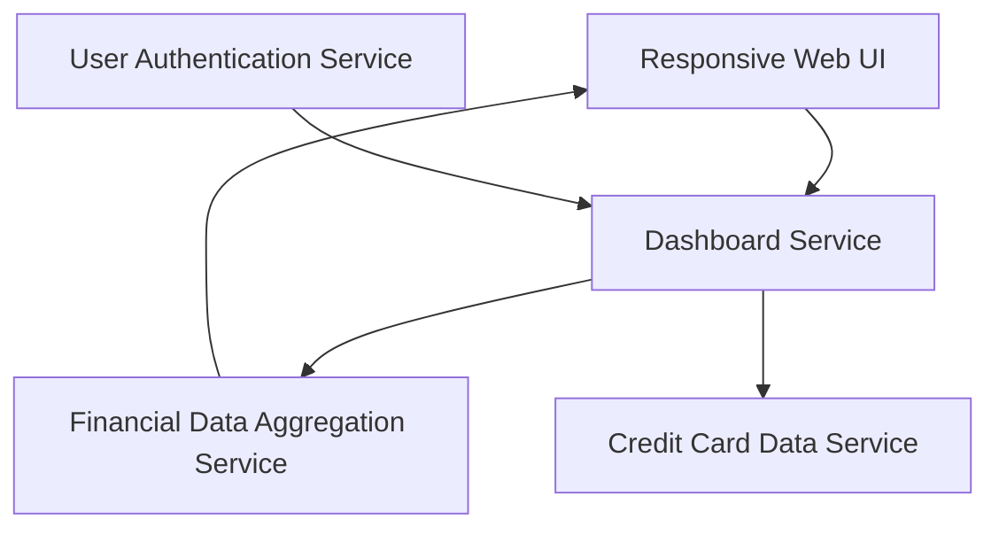

#### 1. High-Level Design

- **Summary**: This epic enables users to view a consolidated dashboard displaying key performance indicators for all their credit cards in a single interface. The core requirement is to provide real-time visibility into critical financial metrics including monthly spend, total credit limit, available credit, and outstanding amounts across all cards. The scope includes KPI display, responsive UI layout supporting mobile, tablet, and desktop devices, and modern, intuitive design patterns.

- **Component Flow**:

- **Integration Points**: 
  - **Upstream**: Credit card data service (provides individual card data), User authentication service (validates user access), Financial data aggregation service (aggregates metrics across all cards)
  - **Downstream**: Responsive Web UI (displays KPIs across different devices)

- **Key Assumptions**: 
  - Financial metrics are calculated in real-time upon dashboard load; available credit is computed as total credit limit minus outstanding amount.
  - Dashboard data refresh occurs on page load; automatic background refresh is not included in this epic's scope.

- **NFR Highlights**: Dashboard must load within 2 seconds; system must support responsive design across mobile, tablet, and desktop devices; UI must be modern and intuitive following industry-standard design patterns.

- **Data Flow**: User accesses dashboard → User Authentication Service validates user session → Dashboard Service requests aggregated financial data from Financial Data Aggregation Service → Financial Data Aggregation Service fetches individual card data from Credit Card Data Service → Metrics (monthly spend, total credit limit, available credit, outstanding amounts) are calculated and aggregated → Dashboard Service returns KPIs to Responsive Web UI → UI renders KPIs in a responsive layout optimized for user's device (mobile/tablet/desktop).

#### 2. Validation Report

- **Requirements Coverage**: The design fully covers all stated requirements including dashboard KPIs display, monthly spend tracking, total credit limit aggregation, available credit calculation, outstanding amount monitoring, responsive UI layout, and multi-device support. The architecture ensures the 2-second load time NFR through efficient data aggregation and caching strategies. Responsive design across mobile, tablet, and desktop is achieved through the Responsive Web UI component. Modern and intuitive UI patterns are implemented following industry standards. All dependencies (Credit card data service, User authentication service, Financial data aggregation service) are integrated into the design. The separation of authentication, data aggregation, and presentation layers ensures security, performance, and maintainability.