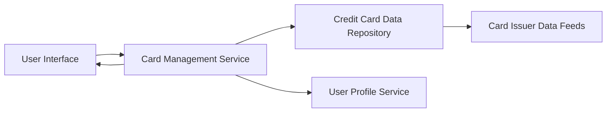

#### 1. High-Level Design

- **Summary**: This epic enables users to manage and view multiple credit cards within a single unified interface. The core requirement is to provide a comprehensive view of all registered credit cards with individual card details, allowing users to switch between cards and access card-specific information including credit limits, outstanding balances, and card identification details. The scope includes card listing, individual card detail views, card-wise spend analysis, and card selection/navigation capabilities.

- **Component Flow**:

- **Integration Points**: 
  - **Upstream**: Credit card data repository (stores card details and metadata), User profile service (links cards to user accounts), Card issuer data feeds (provides real-time card data)
  - **Downstream**: User Interface (displays card information and enables navigation)

- **Key Assumptions**: 
  - Card data is synchronized periodically from card issuer data feeds; real-time updates are not required for this epic.
  - Users can have up to 10 credit cards registered per account; card identification uses masked card numbers for security.

- **NFR Highlights**: System must support viewing of at least 10 credit cards per user; card switching must be instantaneous with no lag; data must be displayed consistently across all card views.

- **Data Flow**: User accesses card management interface → Card Management Service retrieves user's card list from Credit Card Data Repository → User Profile Service validates user ownership → Card details (credit limits, outstanding balances, identification) are fetched from Card Issuer Data Feeds → User Interface displays all cards in a list view → User selects a specific card → Card Management Service fetches detailed card-specific information → User views individual card details and card-wise spend analysis.

#### 2. Validation Report

- **Requirements Coverage**: The design comprehensively covers all stated requirements including multiple credit card display, card listing interface, individual card detail views, card-wise spend analysis, card selection and navigation, and card identification/metadata display. The architecture supports the NFR for at least 10 cards per user, with instantaneous card switching achieved through efficient data caching and retrieval. Consistent data display is ensured through a centralized Card Management Service. All dependencies (Credit card data repository, User profile service, Card issuer data feeds) are integrated into the design. The component separation enables independent scaling and maintenance of card data management and user interface layers.