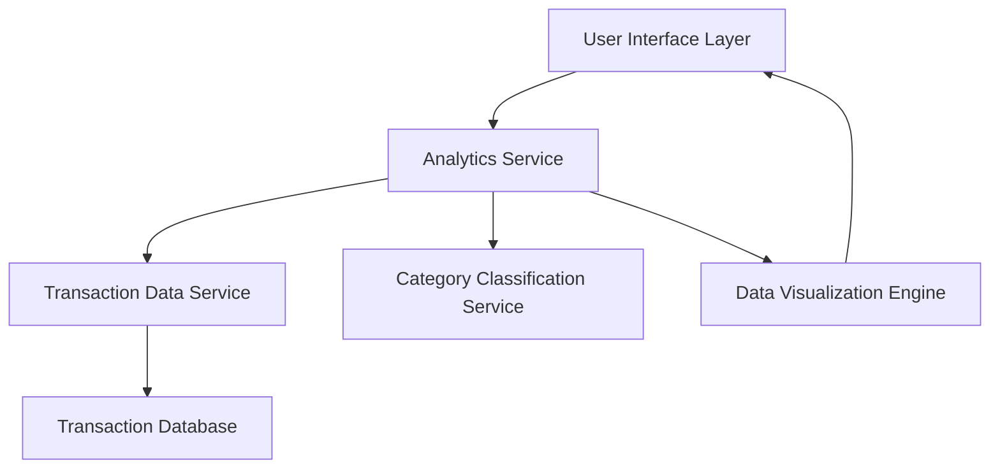

#### 1. High-Level Design

- **Summary**: This epic delivers interactive analytics and visualization capabilities that enable users to understand their spending patterns and transaction history. The core requirement is to provide monthly spend trend visualization and category-wise spending analysis across nine predefined categories (Food & Dining, Fuel, Shopping, Travel, Entertainment, Utilities, Healthcare, Education, and Miscellaneous). The scope includes interactive charts, transaction history views, and spending pattern identification to help users track budget adherence and optimize financial decisions.

- **Component Flow**:

- **Integration Points**: 
  - **Upstream**: Transaction data service (provides raw transaction data), Category classification service (categorizes transactions into 9 predefined categories)
  - **Downstream**: Data visualization library (renders charts and graphs), Analytics engine (processes and aggregates spending data)

- **Key Assumptions**: 
  - Transactions are pre-classified into the nine categories by an upstream service; no manual categorization logic is required in this epic.
  - Monthly spend trends will be calculated based on transaction timestamps; timezone handling will use the user's account default timezone.

- **NFR Highlights**: Analytics visualizations must render within 1 second; system must handle at least 12 months of transaction history; charts must support drill-down capabilities; category calculations must be accurate to 2 decimal places.

- **Data Flow**: User requests spending analytics → Analytics Service fetches transaction data from Transaction Data Service → Category Classification Service categorizes transactions → Analytics Service aggregates data by month and category → Data Visualization Engine renders interactive charts → User views monthly trends and category-wise spending breakdown with drill-down capability.

#### 2. Validation Report

- **Requirements Coverage**: The design covers all stated requirements including monthly spend trend visualization, category-wise analysis across nine categories, interactive charts, transaction history view, and spending pattern identification. The component architecture supports the NFRs for 1-second rendering, 12-month history, drill-down interactivity, and 2-decimal accuracy. All dependencies (Transaction data service, Analytics engine, Data visualization library, Category classification service) are accounted for in the design. The separation of concerns between data retrieval, categorization, analytics processing, and visualization ensures maintainability and scalability.