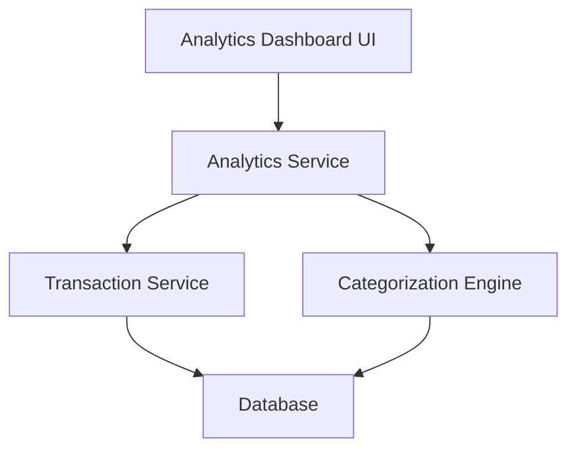

#### 1. High-Level Design

- **Summary:** This epic provides detailed spending analytics with interactive visualizations breaking down expenses by category (9 predefined categories: Food & Dining, Fuel, Shopping, Travel, Entertainment, Utilities, Healthcare, Education, Miscellaneous) and time period. It includes monthly spend trend analysis and card-wise spend analysis for data-driven financial decision-making.

- **Component Flow:**

- **Integration Points:** 
  - **Upstream:** Transaction Service (for retrieving transaction history), Categorization Engine (for assigning transactions to spending categories), Analytics Service (for generating trend reports)
  - **Downstream:** Database (for historical transaction data storage and retrieval)

- **Key Assumptions:** 
  - Transactions are automatically categorized by the Categorization Engine into one of the nine predefined categories.
  - Historical data for at least 12 months is available and accessible for trend analysis.

- **NFR Highlights:** Analytics visualizations must render within 3 seconds; support filtering and drill-down capabilities; handle historical data for at least 12 months; maintain data accuracy for all calculations.

- **Data Flow:** User requests spending analytics → Analytics Service retrieves transaction history from Transaction Service → Categorization Engine assigns categories to transactions → Analytics Service aggregates data by category, time period, and card → Calculated trends and insights are returned to Analytics Dashboard UI → Interactive visualizations render within 3-second constraint with filtering and drill-down capabilities.

#### 2. Validation Report

- **Requirements Coverage:** The design comprehensively covers category-wise spending visualization, monthly spend trends, card-wise spend analysis, interactive charts, transaction categorization across nine categories, and spending pattern identification. The architecture meets NFR requirements for 3-second rendering, filtering/drill-down capabilities, and 12-month historical data handling. All dependencies (Transaction Service, Categorization Engine, Analytics Service) are integrated.