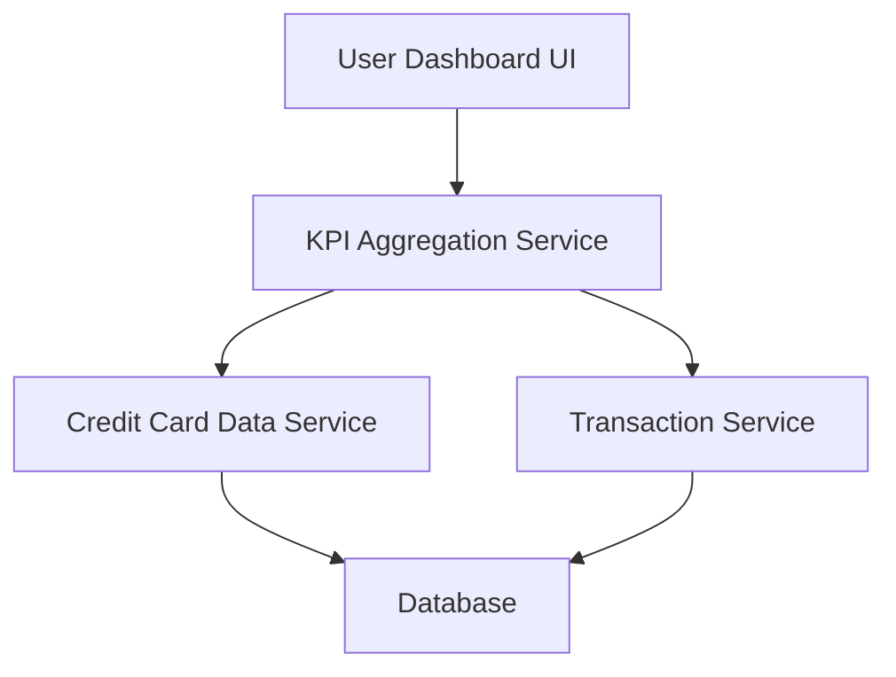

#### 1. High-Level Design

- **Summary:** This epic delivers a comprehensive dashboard displaying key performance indicators for the credit card portfolio, including monthly spending, total credit limit, available credit, and outstanding amounts. The dashboard provides real-time financial health metrics in a consolidated, responsive view.

- **Component Flow:**

- **Integration Points:** 
  - **Upstream:** Credit Card Data Service (for retrieving card balances and limits), Transaction Service (for calculating monthly spend and outstanding amounts)
  - **Downstream:** Database (for real-time data retrieval)

- **Key Assumptions:** 
  - Monthly spend is calculated based on transaction data aggregated within the current calendar month.
  - Real-time data updates are achieved through periodic polling or event-driven mechanisms from backend services.

- **NFR Highlights:** Dashboard must load within 2 seconds; support responsive design for mobile and desktop devices; handle real-time data updates for KPI metrics.

- **Data Flow:** User accesses dashboard → KPI Aggregation Service requests data from Credit Card Data Service (total limits, available credit, outstanding amounts) and Transaction Service (monthly spend) → Services query Database for current data → Aggregated KPIs are calculated and returned to Dashboard UI → UI renders consolidated view within 2-second load time constraint.

#### 2. Validation Report

- **Requirements Coverage:** The design addresses all core requirements including monthly spend display, total credit limit calculation, available credit tracking, outstanding amount summary, and consolidated KPI view. The architecture supports the NFR constraints of 2-second load time and responsive design. Dependencies on Credit Card Data Service and Transaction Service are properly integrated.