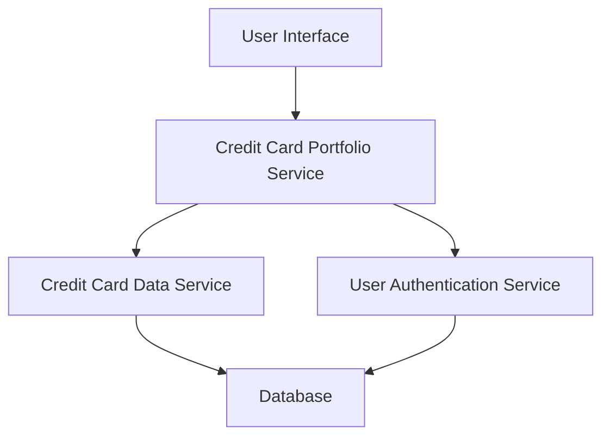

#### 1. High-Level Design

- **Summary:** This epic enables users to manage and view multiple credit cards within a unified interface. Users can view consolidated portfolio information including card-specific credit limits, available credit, and outstanding balances for up to 20 credit cards simultaneously.

- **Component Flow:**

- **Integration Points:** 
  - **Upstream:** User Authentication Service (for user-specific card portfolio access)
  - **Downstream:** Credit Card Data Service (for retrieving individual card information including limits, balances, and outstanding amounts)

- **Key Assumptions:** 
  - Card data is pre-categorized and stored in a structured format accessible via the Credit Card Data Service.
  - User authentication tokens are valid and provide access control to user-specific card portfolios.

- **NFR Highlights:** System must support viewing up to 20 credit cards per user with consistent performance; responsive UI must adapt to various screen sizes.

- **Data Flow:** User authenticates and requests portfolio view → Authentication Service validates user → Portfolio Service retrieves card list for authenticated user → Credit Card Data Service fetches individual card details (limits, available credit, outstanding balances) from Database → Aggregated data is returned to UI for consolidated display.

#### 2. Validation Report

- **Requirements Coverage:** The design fully covers the epic's stated scope including multiple credit card display, card-specific details, individual tracking of credit limits, available credit, and outstanding balances. The architecture supports the NFR of handling up to 20 cards with responsive UI. All identified dependencies (Credit Card Data Service, User Authentication Service) are integrated into the component flow.