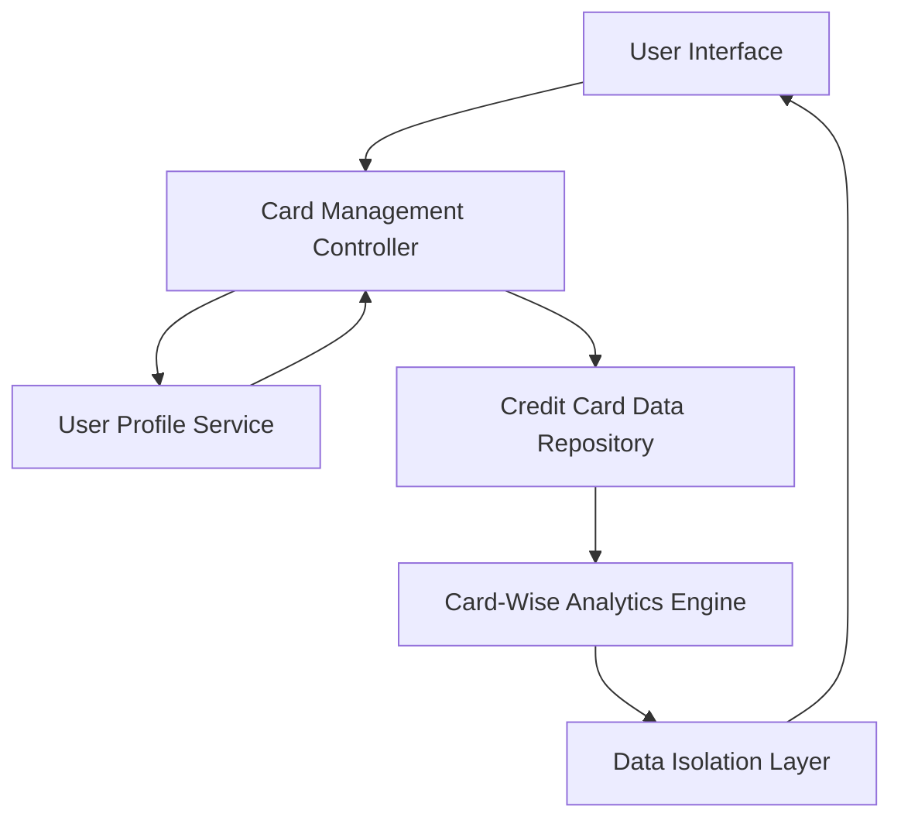

#### 1. High-Level Design

- **Summary:** This epic enables users to manage and monitor multiple credit cards (up to at least 10 per user) within a single interface. Users can view individual card details, track card-specific spending, analyze financial metrics on a per-card basis, and filter/select cards for detailed analysis. The feature provides card-wise spend analysis to help users understand card utilization and spending distribution across their portfolio.

- **Component Flow:**

- **Integration Points:**
  - **Upstream:** User profile service (for card ownership validation and user account management)
  - **Data Store:** Credit card data repository (for storing and retrieving card information and balances)
  - **Internal:** Card-wise analytics engine (for computing card-specific spending metrics)

- **Key Assumptions:**
  - Card data repository supports efficient querying for up to 10 cards per user with sub-1-second retrieval times; indexing and data partitioning strategies are in place.
  - User profile service provides card ownership metadata; card-to-user associations are maintained externally and synchronized periodically.

- **NFR Highlights:** System must support at least 10 credit cards per user, card data retrieval must complete within 1 second, and ensure data isolation between different user accounts.

#### 2. Validation Report

- **Requirements Coverage:** The design fully covers the scope including multiple credit card display, card-wise spend analysis, individual card details view, card selection and filtering, and card-specific balance tracking. The architecture satisfies the NFRs for supporting at least 10 cards per user, 1-second data retrieval, and data isolation between accounts. Dependencies on user profile service and credit card data repository are properly identified and integrated. Out-of-scope elements (real bank integration, card payments, fund transfers, card application process) are excluded as specified.