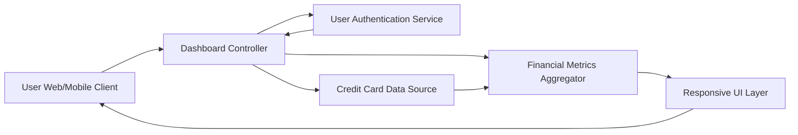

#### 1. High-Level Design

- **Summary:** This epic provides a consolidated dashboard that displays key financial metrics across all user credit cards. Users can monitor monthly spending, total credit limit, available credit, and outstanding amounts from a single, responsive interface with real-time data updates. The dashboard serves as the central hub for overall financial position visibility.

- **Component Flow:**

- **Integration Points:**
  - **Upstream:** Credit card data sources (for balance, transaction, and credit limit information)
  - **Upstream:** User authentication service (for secure access and user identity validation)
  - **Internal:** Financial metrics aggregator (consolidates data across multiple cards)

- **Key Assumptions:**
  - Credit card data sources provide near real-time APIs or data feeds with sub-2-second response times to meet dashboard load requirements.
  - User authentication is handled by an existing enterprise identity service; session management and token refresh are externally managed.

- **NFR Highlights:** Dashboard must load within 2 seconds, support responsive design for mobile and desktop devices, and handle real-time data updates for financial metrics.

#### 2. Validation Report

- **Requirements Coverage:** The design addresses all scope elements including monthly spend display, total credit limit calculation, available credit tracking, outstanding amount monitoring, responsive dashboard layout, and consolidated multi-card view. The architecture supports the NFRs for 2-second load time, responsive design, and real-time data updates. Integration with credit card data sources and user authentication service aligns with stated dependencies. Out-of-scope items (real bank integration, payments, fund transfers) are appropriately excluded from the design.