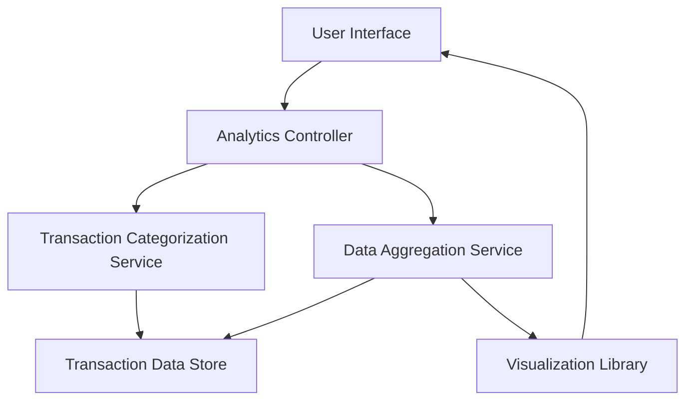

#### 1. High-Level Design

- **Summary:** This epic delivers an analytics module that provides users with interactive visualizations to understand spending patterns across nine predefined categories (Food & Dining, Fuel, Shopping, Travel, Entertainment, Utilities, Healthcare, Education, Miscellaneous). Users can view monthly spend trends over time and analyze category-wise spending breakdowns to identify habits and optimize financial behavior.

- **Component Flow:**

- **Integration Points:**
  - **Upstream:** Transaction categorization service or engine (for classifying transactions into spending categories)
  - **Upstream:** Data aggregation service (for computing spending trends and summaries)
  - **Upstream:** Visualization library (for rendering interactive charts and graphs)
  - **Data Source:** Transaction data store (historical transaction records)

- **Key Assumptions:**
  - Transactions are pre-categorized or categorization logic is provided by an external service; category mapping rules are predefined and maintained externally.
  - Historical data is available for at least 12 months in a queryable format with acceptable performance.

- **NFR Highlights:** Analytics visualizations must render within 3 seconds, support interactive filtering and drill-down capabilities, and handle historical data for at least 12 months.

#### 2. Validation Report

- **Requirements Coverage:** The design covers all stated scope elements including category-wise spending visualization, monthly spend trends analysis, interactive charts, spending breakdown by nine predefined categories, and trend identification over time periods. The architecture accommodates the NFRs for rendering performance (3 seconds), interactivity, and 12-month historical data retention. Integration points with transaction categorization, data aggregation, and visualization libraries are identified and aligned with stated dependencies.