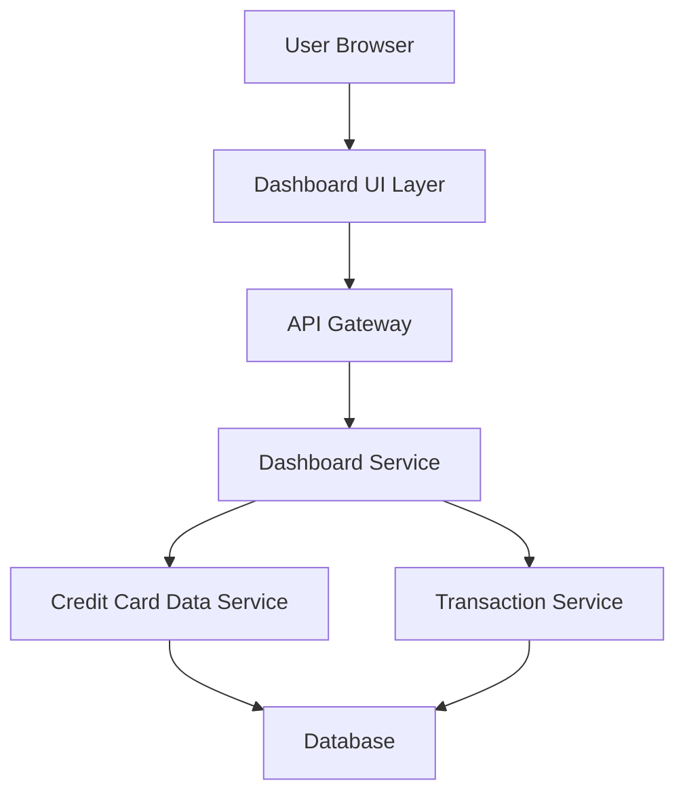

#### 1. High-Level Design

- **Summary:** This epic delivers a responsive dashboard interface that consolidates key performance indicators (KPIs) for users' credit card portfolios. The dashboard displays monthly spend, total credit limit, available credit, and outstanding amounts across all credit cards, providing users with a centralized view of their credit card financial health to support informed financial planning and credit utilization management.

- **Component Flow:**

- **Integration Points:**
  - **Upstream:** Credit Card Data Service (for retrieving card balances, credit limits, and outstanding amounts)
  - **Upstream:** Transaction Service (for calculating monthly spend totals and transaction aggregation)
  - **Downstream:** User Browser/Mobile Client (responsive UI rendering)

- **Key Assumptions:**
  - Monthly spend is calculated based on the current calendar month (first day to current date or end of month).
  - Credit card data is refreshed in near real-time or on-demand when the dashboard loads, with data consistency maintained across services.

- **NFR Highlights:** Dashboard must load within 2 seconds; must support responsive layouts across desktop, tablet, and mobile devices; real-time data refresh capability required for KPI metrics.

- **Data Flow:** User accesses the dashboard through their browser. The Dashboard UI Layer requests KPI data via the API Gateway, which routes requests to the Dashboard Service. The Dashboard Service orchestrates calls to the Credit Card Data Service (to fetch credit limits, balances, outstanding amounts) and Transaction Service (to calculate monthly spend). Data is retrieved from the Database, aggregated, and returned through the API Gateway to the UI Layer, where KPIs are rendered in a responsive layout.

#### 2. Validation Report

- **Requirements Coverage:** The design fully covers the epic's stated scope including dashboard interface, monthly spend calculation, total credit limit aggregation, available credit computation, outstanding amount tracking, and responsive layout implementation. All NFRs (2-second load time, responsive design, real-time refresh) are addressed through appropriate service architecture and UI layer design. Integration dependencies with credit card data service and transaction service are clearly mapped. Out-of-scope items (real bank integration, payments, fund transfers, loans, payment gateway) are appropriately excluded from the design.