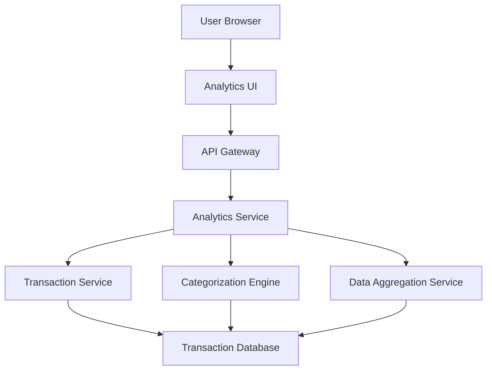

#### 1. High-Level Design

- **Summary:** This epic provides interactive visualizations and analytical capabilities for users to understand spending patterns through category-wise analysis and monthly spend trends. Users can explore spending across nine predefined categories (Food & Dining, Fuel, Shopping, Travel, Entertainment, Utilities, Healthcare, Education, Miscellaneous) and track trends over time. The analytics deliver actionable insights to help users optimize expenses and make informed financial decisions.

- **Component Flow:**

- **Integration Points:**
  - **Upstream:** Transaction Service (for raw transaction data retrieval)
  - **Upstream:** Category Classification Service/Algorithm (for transaction categorization into predefined categories)
  - **Upstream:** Data Aggregation Service (for trend calculations and time-based spending comparisons)
  - **Downstream:** User Browser/Mobile Client (interactive charts and visualizations)

- **Key Assumptions:**
  - Transactions are automatically categorized using a classification algorithm or service based on merchant information, transaction description, or MCC codes.
  - Historical data is retained for at least 12 months to support trend analysis, with monthly aggregations pre-calculated or computed on-demand.

- **NFR Highlights:** Analytics visualizations must render within 3 seconds; system must support historical data analysis for at least 12 months; category classification accuracy must be maintained for transaction processing.

- **Data Flow:** User accesses the analytics interface through their browser. The Analytics UI requests spending insights via the API Gateway to the Analytics Service. The service retrieves raw transaction data from the Transaction Service, processes it through the Categorization Engine to classify transactions into nine predefined categories, and uses the Data Aggregation Service to calculate monthly trends and category-wise spending totals. Aggregated data from the Transaction Database is transformed into visualization-ready format and returned to the UI, where interactive charts and graphs display spending patterns, category breakdowns, and monthly trends.

#### 2. Validation Report

- **Requirements Coverage:** The design fully addresses the epic's scope including category-wise spending visualization, monthly spend trend analysis, interactive charts and graphs, spending pattern identification across nine predefined categories, transaction categorization engine, and time-based spending comparisons. All NFRs are covered: 3-second rendering time for visualizations, 12-month historical data support, and category classification accuracy maintenance. Integration dependencies with transaction service, category classification service, and data aggregation service are clearly defined. Out-of-scope items (real bank integration, predictive analytics, budget setting and alerts, custom category creation, export functionality) are appropriately excluded from the design.