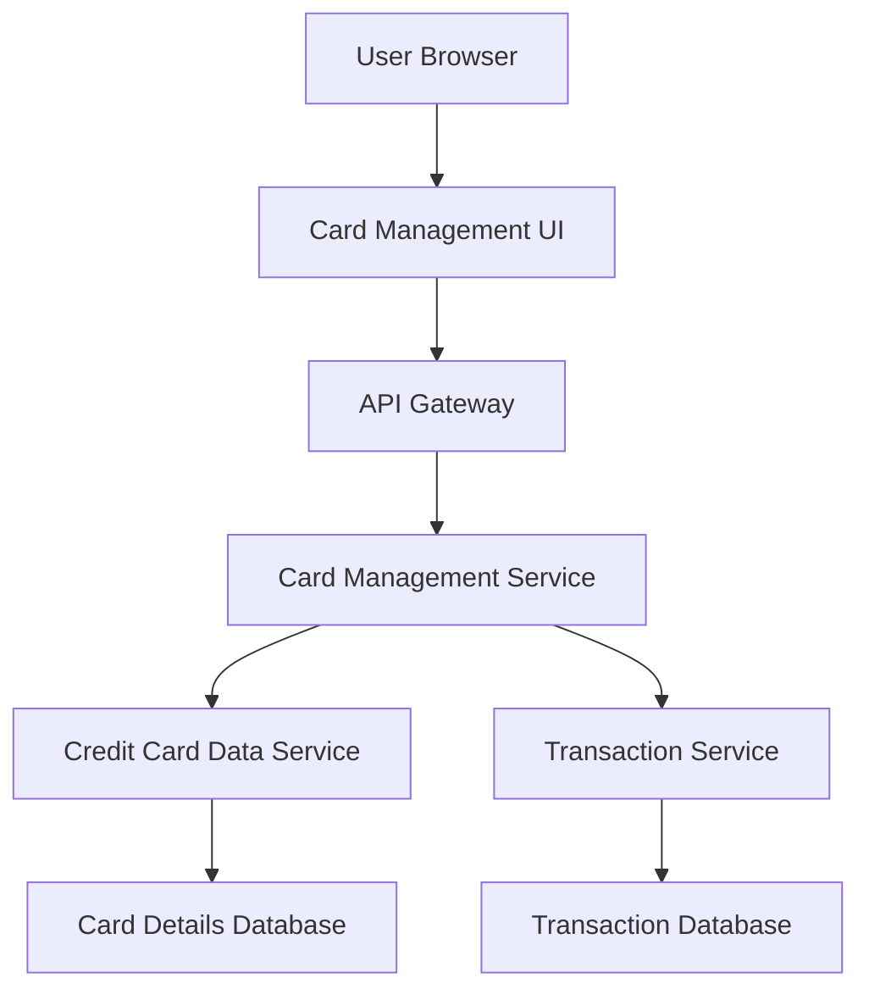

#### 1. High-Level Design

- **Summary:** This epic enables users to manage and view multiple credit cards within a consolidated dashboard interface. Users can access card-wise spend analysis, view individual card details, and analyze spending patterns for each card separately. The functionality supports comparison of performance across different cards and helps users optimize card usage based on individual card benefits and limits.

- **Component Flow:**

- **Integration Points:**
  - **Upstream:** Credit Card Data Service (for card details, metadata, credit limits, and balances)
  - **Upstream:** Transaction Service (for card-specific transaction history and spend calculations)
  - **Downstream:** User Browser/Mobile Client (card listing and card-specific views)

- **Key Assumptions:**
  - Each credit card is uniquely identifiable by a card ID or token, and users can have up to 20 cards associated with their account.
  - Card-wise spend analysis is calculated by filtering transactions based on the card identifier, with data aggregated by card for the selected time period.

- **NFR Highlights:** System must handle up to 20 credit cards per user without performance degradation; card data retrieval must complete within 1 second; secure storage and display of card information required.

- **Data Flow:** User accesses the card management interface through their browser. The Card Management UI requests card listing via the API Gateway to the Card Management Service. The service retrieves card details from the Credit Card Data Service (card metadata, limits, balances) and card-specific transaction data from the Transaction Service. Data from Card Details Database and Transaction Database is aggregated per card and returned to the UI, where users can view all cards, select individual cards, and see card-wise spend analysis and details.

#### 2. Validation Report

- **Requirements Coverage:** The design comprehensively covers the epic's scope including multiple credit card display, card-wise spend analysis, individual card details view, card selection and filtering, and card-specific credit limit and balance tracking. NFRs are addressed through scalable architecture supporting 20 cards per user, 1-second retrieval SLA, and secure data handling. Integration dependencies with credit card data service and transaction service are properly mapped. Out-of-scope items (real bank integration, card payments, fund transfers, adding/removing physical cards) are excluded as specified.