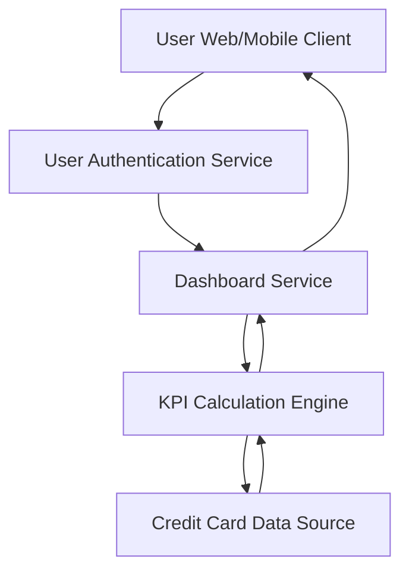

#### 1. High-Level Design

- **Summary**: This epic creates a centralized dashboard displaying key credit card KPIs including monthly spend, total credit limit, available credit, and outstanding amounts. The dashboard provides real-time visibility into overall credit card financial health in a single consolidated, responsive interface.

- **Component Flow**:

- **Integration Points**: 
  - **Upstream**: User Authentication Service (for secure access control)
  - **Downstream**: Credit Card Data Source/Database (for retrieving card balances and transaction data for KPI calculations)

- **Key Assumptions**: 
  - Credit card data source provides real-time or near-real-time data for accurate KPI calculations.
  - Monthly spend is calculated based on current billing cycle or calendar month (to be clarified with business).

- **NFR Highlights**: Dashboard must load within 2 seconds, support responsive design (mobile and desktop), handle real-time data refresh, ensure data accuracy for financial calculations.

- **Data Flow**: User accesses dashboard → Authentication Service validates user credentials → Dashboard Service requests KPI data → KPI Calculation Engine retrieves card balances and transaction data from Credit Card Data Source → Engine calculates monthly spend, total credit limit, available credit, and outstanding amounts → Aggregated KPIs returned to Dashboard Service → Responsive dashboard UI renders KPI visualization components optimized for user's device (mobile/desktop) → Real-time refresh mechanism periodically updates KPIs.

#### 2. Validation Report

- **Requirements Coverage**: The design comprehensively addresses all stated requirements: monthly spend display, total credit limit calculation, available credit tracking, outstanding amount monitoring, responsive layout, and KPI visualization. Integration with credit card data source and user authentication service is included. NFRs for 2-second load time, responsive design, real-time refresh, and data accuracy are supported through dedicated KPI Calculation Engine, responsive UI components, and direct integration with authoritative credit card data source.