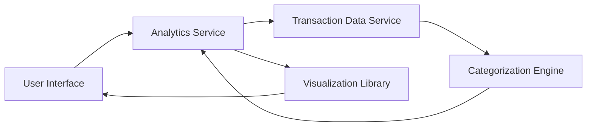

#### 1. High-Level Design

- **Summary**: This epic provides comprehensive spending analytics with interactive visualizations showing category-wise spending across 9 predefined categories (Food & Dining, Fuel, Shopping, Travel, Entertainment, Utilities, Healthcare, Education, Miscellaneous) and monthly trend analysis. The solution transforms raw transaction data into actionable insights through charts and graphs.

- **Component Flow**:

- **Integration Points**: 
  - **Upstream**: Transaction Data Service (for retrieving historical spending data up to 12 months)
  - **Downstream**: Categorization Engine/Service (for classifying transactions into 9 spending categories), Visualization Library (for rendering interactive charts and graphs)

- **Key Assumptions**: 
  - Transactions contain sufficient metadata (merchant name, MCC codes, or descriptions) for accurate categorization.
  - Historical transaction data is retained for at least 12 months and accessible via API.

- **NFR Highlights**: Visualizations must render within 2 seconds, support interactive filtering/drill-down, handle 12+ months of transaction history, ensure accurate categorization.

- **Data Flow**: User requests analytics view → Analytics Service retrieves transaction history from Transaction Data Service → Categorization Engine classifies each transaction into one of 9 predefined categories → Analytics Service aggregates spending by category and time period → Visualization Library renders interactive charts/graphs → User interacts with visualizations (filtering, drill-down) triggering re-aggregation and re-rendering.

#### 2. Validation Report

- **Requirements Coverage**: The design fully covers category-wise spending visualization, monthly trend analysis, interactive charts, spending pattern identification, and transaction categorization across 9 categories. Integration dependencies (transaction data service, categorization engine, visualization library) are incorporated. NFRs for 2-second rendering, interactive capabilities, 12-month history, and accurate categorization are addressed through dedicated analytics and categorization services with performance-optimized data retrieval.