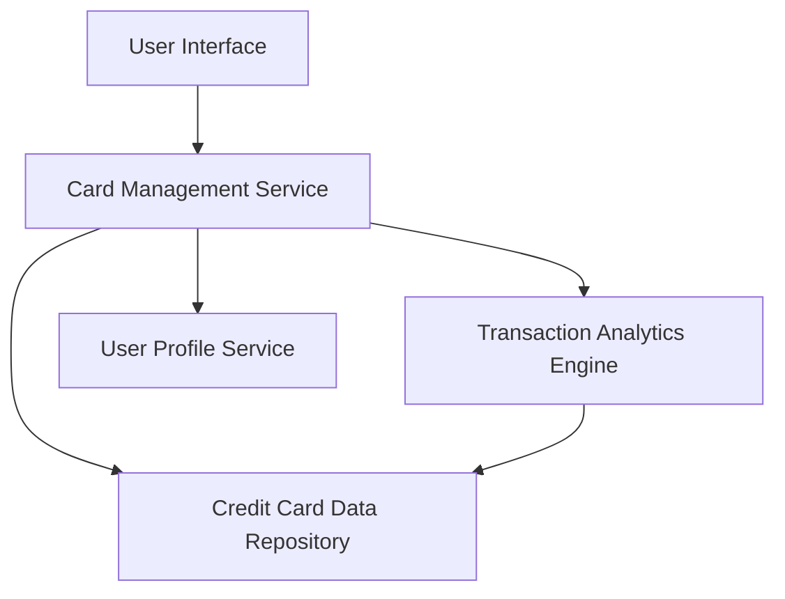

#### 1. High-Level Design

- **Summary**: This epic delivers a unified interface for managing multiple credit cards, enabling users to view all cards, access card-specific details (limits, balances, spending patterns), and perform card-wise spend analysis. The solution consolidates multi-card visibility, eliminating the need for multiple banking portal logins.

- **Component Flow**:

- **Integration Points**: 
  - **Upstream**: User Profile Service (for linking cards to user accounts)
  - **Downstream**: Credit Card Data Repository/API (for retrieving card information and balances), Transaction Service (for card-specific spending data)

- **Key Assumptions**: 
  - Card data is available via API or database with standardized schema including card ID, limit, balance, and masked number.
  - Transaction data is pre-associated with specific card identifiers for card-wise analysis.

- **NFR Highlights**: System must support at least 10 cards per user, card data retrieval within 3 seconds, secure storage with masked card numbers.

- **Data Flow**: User authenticates and requests card list → Card Management Service queries User Profile Service to retrieve linked card IDs → Service fetches card details (limits, balances) from Credit Card Data Repository → Transaction Analytics Engine aggregates spending data per card → Consolidated card information and spend analysis displayed in UI with masked card numbers for security.

#### 2. Validation Report

- **Requirements Coverage**: The design addresses all core requirements: multiple card display, card-wise spend analysis, individual card details, filtering, balance tracking, and per-card credit utilization. Integration with required services (card data repository, user profile, transaction service) is included. NFRs for 10+ cards, 3-second retrieval, and secure masked display are architecturally supported through dedicated services and data repository design.