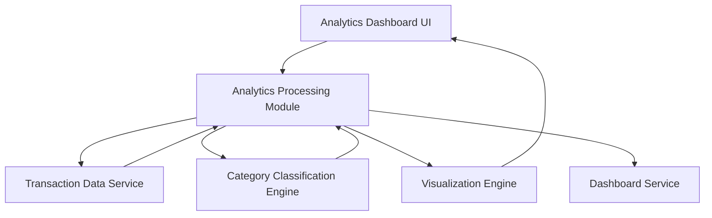

#### 1. High-Level Design

- **Summary:** This epic delivers comprehensive analytics and interactive visualizations for understanding spending patterns through category-wise analysis across nine predefined categories (Food & Dining, Fuel, Shopping, Travel, Entertainment, Utilities, Healthcare, Education, Miscellaneous). It provides actionable insights into spending behavior, helping users identify high-expenditure areas and financial optimization opportunities through visual representations and trend analysis.

- **Component Flow:**

- **Integration Points:** 
  - **Upstream:** Transaction data service (for detailed transaction records)
  - **Upstream:** Category classification engine (for transaction categorization)
  - **Downstream:** Dashboard service (for consolidated view integration)

- **Key Assumptions:** 
  - Category classification is automated using predefined rules or ML models; transactions are assigned to one primary category
  - Monthly spend trends aggregate transactions by category and month for time-series analysis

- **NFR Highlights:** Visualization rendering must be performant with large transaction datasets; analytics calculations must be accurate and consistent; interactive charts must be responsive and support user interactions with minimal latency

#### 2. Validation Report

- **Requirements Coverage:** The design comprehensively covers all requirements including interactive visualizations, category-wise analysis across all nine categories, transaction display, spending pattern identification, monthly trend charts, and analytical reporting. The architecture addresses data retrieval, classification, analytics computation, and visualization rendering. Integration with dashboard service enables consolidated portfolio view as specified in the epic.