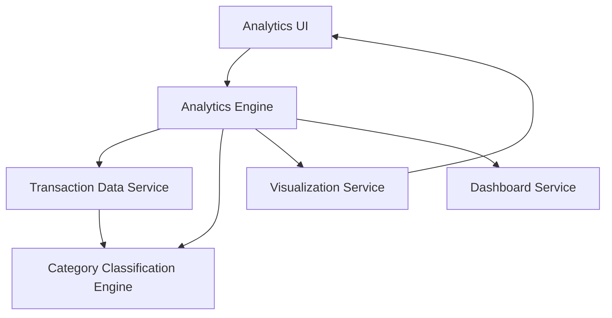

#### 1. High-Level Design

- **Summary:** This epic delivers comprehensive analytics and interactive visualizations enabling users to understand spending patterns through category-wise analysis. Users can explore transactions across nine predefined categories (Food & Dining, Fuel, Shopping, Travel, Entertainment, Utilities, Healthcare, Education, Miscellaneous), identify spending behavior patterns, and discover cost-saving opportunities through visual representations and trend analysis.

- **Component Flow:**

- **Integration Points:** 
  - **Upstream:** Transaction data service for detailed transaction records
  - **Upstream:** Category classification engine for transaction categorization
  - **Downstream:** Dashboard service for consolidated view integration

- **Key Assumptions:** 
  - Category classification is automated using predefined rules or machine learning models with minimal manual intervention
  - Monthly spend trends are calculated and cached to optimize visualization rendering performance

- **NFR Highlights:** Visualization rendering must be performant with large transaction datasets; Analytics calculations must be accurate and consistent; Interactive charts must be responsive and support user interactions with minimal latency

#### 2. Validation Report

- **Requirements Coverage:** The design fully addresses all scope items including interactive visualizations, category-wise analysis across nine categories, transaction data display, spending pattern identification, monthly trend charts, and analytical reporting. The architecture supports the NFRs for performance, accuracy, and responsiveness through proper service integration, classification engine, and optimized visualization rendering.