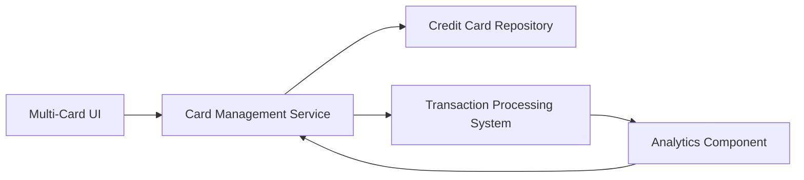

#### 1. High-Level Design

- **Summary:** This epic enables users to manage and monitor multiple credit cards within a single platform. Users can view all credit cards with individual details, track card-specific spending patterns, analyze performance across their portfolio, and understand card utilization to optimize credit card usage based on benefits and spending categories.

- **Component Flow:**

- **Integration Points:** 
  - **Upstream:** Credit card data repository for card information
  - **Upstream:** Transaction processing system for card-specific spending data
  - **Internal:** Analytics component for card comparison and trend analysis

- **Key Assumptions:** 
  - Card comparison is based on spending volume, utilization rate, and category distribution
  - Card-specific balance tracking updates are synchronized with transaction processing in near-real-time

- **NFR Highlights:** System must handle display and processing of multiple cards per user account; Performance must remain consistent regardless of number of cards; Data integrity must be maintained across all card records

#### 2. Validation Report

- **Requirements Coverage:** The design covers all scope elements including multiple card display, card-wise spend analysis, individual card details, comparison capabilities, balance tracking, and monthly trends per card. The architecture ensures NFR compliance for multi-card handling, consistent performance, and data integrity through proper service decomposition and repository integration.