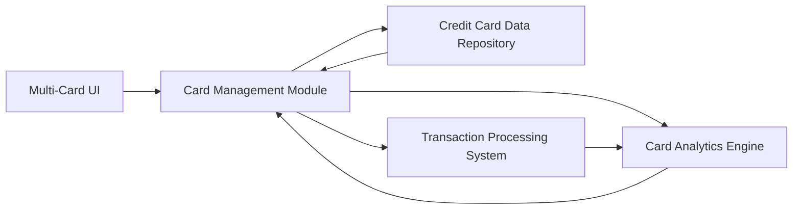

#### 1. High-Level Design

- **Summary:** This epic enables users to manage and monitor multiple credit cards within a single platform. It provides individual card details, card-specific spending patterns, and portfolio-wide analysis. The feature includes card-wise spend analysis to help users understand card utilization effectiveness and optimize credit card usage based on benefits and spending categories.

- **Component Flow:**

- **Integration Points:** 
  - **Upstream:** Credit card data repository (for card information)
  - **Upstream:** Transaction processing system (for card-specific spending data)

- **Key Assumptions:** 
  - Each card has unique identifier for tracking and analysis; card comparison uses normalized metrics for fair evaluation
  - Monthly spend trends are calculated per card and aggregated for portfolio-level insights

- **NFR Highlights:** System must handle display and processing of multiple cards per user account; performance must remain consistent regardless of number of cards; data integrity must be maintained across all card records

#### 2. Validation Report

- **Requirements Coverage:** The design fully addresses the epic's scope including multiple card display, card-wise spend analysis, individual card details, comparison capabilities, balance tracking, and monthly trends per card. The component architecture supports scalable multi-card processing with dedicated analytics engine. Integration points ensure data consistency and comprehensive spending analysis across the portfolio.