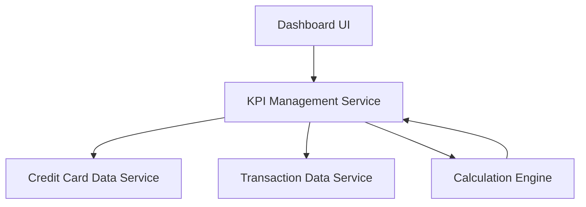

#### 1. High-Level Design

- **Summary:** This epic delivers a modern, responsive dashboard providing users with a consolidated view of their credit card portfolio and key performance indicators. Users can monitor essential financial metrics including monthly spend, total credit limit, available credit, and outstanding amounts across all credit cards from a unified interface serving as the central hub for credit card financial management.

- **Component Flow:**

- **Integration Points:** 
  - **Upstream:** Internal credit card data service for retrieving card details and balances
  - **Upstream:** Transaction data service for monthly spend calculations

- **Key Assumptions:** 
  - Real-time calculations are cached or optimized to meet dashboard load time requirements
  - Multi-card consolidated view aggregates data across all user-owned cards without filtering

- **NFR Highlights:** System must support responsive design across desktop, tablet, and mobile devices; Dashboard load time must be optimized for quick access to financial data; Real-time calculation accuracy for credit limits and available credit

#### 2. Validation Report

- **Requirements Coverage:** The design addresses all scope items including dashboard interface, all four KPI displays, responsive layout, and multi-card consolidated view. The component architecture supports the NFRs for responsive design, optimized load times, and real-time calculation accuracy through proper service integration and calculation engine implementation.