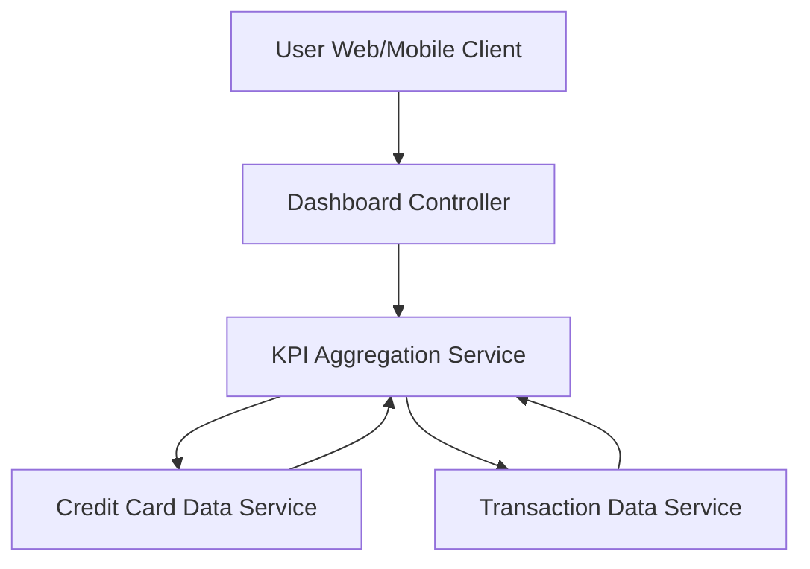

#### 1. High-Level Design

- **Summary:** This epic delivers a modern, responsive dashboard serving as the central hub for credit card financial management. It provides a consolidated view of the credit card portfolio with essential financial metrics (monthly spend, total credit limit, available credit, outstanding amounts) across all credit cards, enabling users to quickly assess overall credit health and spending status.

- **Component Flow:**

- **Integration Points:** 
  - **Upstream:** Internal credit card data service (for retrieving card details and balances)
  - **Upstream:** Transaction data service (for monthly spend calculations)

- **Key Assumptions:** 
  - Dashboard displays aggregated KPIs across all user's credit cards with drill-down capability to individual cards
  - Real-time calculation refers to on-demand computation at dashboard load, not continuous streaming updates

- **NFR Highlights:** System must support responsive design across desktop, tablet, and mobile devices; dashboard load time must be optimized for quick access to financial data; real-time calculation accuracy for credit limits and available credit

#### 2. Validation Report

- **Requirements Coverage:** The design comprehensively addresses all requirements including dashboard interface, all four KPIs, responsive layout, and multi-card consolidated view. The architecture supports real-time calculation accuracy and optimized load times through dedicated KPI aggregation service. Integration with credit card and transaction services enables complete portfolio visibility as specified.