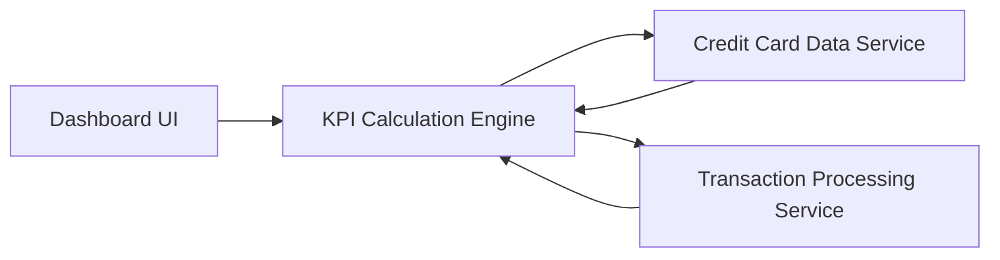

#### 1. High-Level Design

- **Summary:** This epic provides a comprehensive dashboard displaying key performance indicators (KPIs) for the credit card portfolio, including monthly spending, total credit limit, available credit, and outstanding amounts. It offers a consolidated view for tracking multiple credit cards simultaneously, giving users complete visibility into their credit card financial health.

- **Component Flow:**

- **Integration Points:** 
  - **Upstream:** Credit card data service (for retrieving card details and balances)
  - **Upstream:** Transaction processing service (for calculating monthly spend and outstanding amounts)

- **Key Assumptions:** 
  - KPIs are calculated in real-time or near-real-time based on current card balances and transaction data
  - Available credit is derived as total credit limit minus outstanding amount per card, then aggregated

- **NFR Highlights:** System must support responsive layouts across desktop, tablet, and mobile devices; dashboard load time must be optimized for quick KPI rendering; UI must handle multiple credit cards without performance degradation

#### 2. Validation Report

- **Requirements Coverage:** The design fully covers the epic's scope including all four KPIs (monthly spend, total credit limit, available credit, outstanding amount), multi-card view, and responsive layout. The component flow addresses data retrieval and KPI calculation logic. Integration points with credit card and transaction services support the consolidated dashboard requirements.