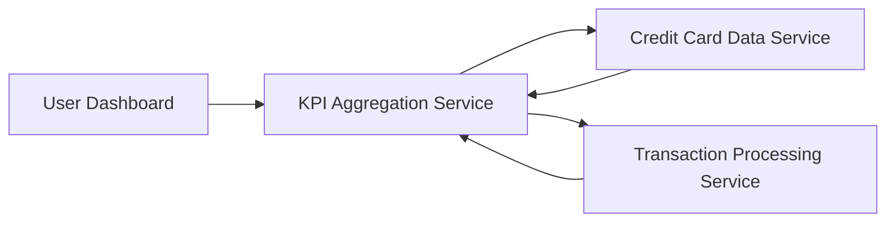

#### 1. High-Level Design

- **Summary:** This epic enables users to view a comprehensive dashboard displaying key performance indicators for their credit card portfolio. Users can monitor monthly spending, total credit limit, available credit, and outstanding amounts in a consolidated view across multiple credit cards, providing complete visibility into their credit card financial health.

- **Component Flow:**

- **Integration Points:** 
  - **Upstream:** Credit card data service for retrieving card details and balances
  - **Upstream:** Transaction processing service for calculating monthly spend and outstanding amounts

- **Key Assumptions:** 
  - KPI calculations are performed in real-time or near-real-time with acceptable latency for dashboard rendering
  - Monthly spend is calculated based on the current calendar month and resets at month boundaries

- **NFR Highlights:** System must support responsive layouts across desktop, tablet, and mobile devices; Dashboard load time must be optimized for quick KPI rendering; UI must handle multiple credit cards without performance degradation

#### 2. Validation Report

- **Requirements Coverage:** The design fully covers the scope including all four KPI displays (monthly spend, total credit limit, available credit, outstanding amount), multiple credit card view, and responsive layout. The architecture ensures integration with necessary backend services while meeting the NFRs for responsiveness, performance, and scalability across multiple cards.