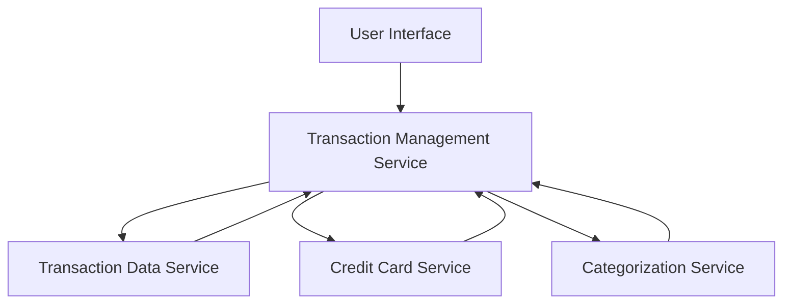

#### 1. High-Level Design

- **Summary:** This epic provides comprehensive transaction management capabilities allowing users to view, search, and filter credit card transactions across all their cards. Users can access detailed transaction information, verify charges, and maintain transparency into their spending history through a clear, organized interface supporting multiple credit cards.

- **Component Flow:**

- **Integration Points:** 
  - **Upstream:** Transaction data service for retrieving transaction history
  - **Upstream:** Credit card service for associating transactions with specific cards
  - **Upstream:** Categorization service for assigning categories to transactions

- **Key Assumptions:** 
  - Pagination is implemented with a default page size optimized for performance and user experience
  - Search and filter operations are indexed for efficient query execution on large datasets

- **NFR Highlights:** Transaction list must support pagination for large datasets; Search and filter operations must execute within acceptable response times; System must handle high volume of transaction records efficiently

#### 2. Validation Report

- **Requirements Coverage:** The design addresses all scope elements including transaction listing, search and filtering, multi-card view, transaction details, and responsive interface. The architecture supports the NFRs for pagination, performance, and high-volume handling through proper service decomposition and integration with backend data services.