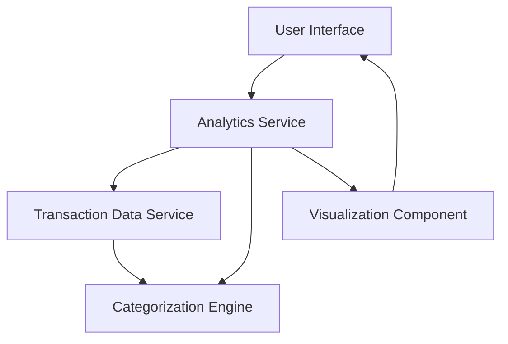

#### 1. High-Level Design

- **Summary:** This epic delivers interactive analytics and visualization capabilities for credit card spending patterns. Users can view spending breakdowns across nine predefined categories (Food & Dining, Fuel, Shopping, Travel, Entertainment, Utilities, Healthcare, Education, Miscellaneous), analyze monthly spend trends, and perform card-wise spend analysis to identify spending habits and make data-driven financial decisions.

- **Component Flow:**

- **Integration Points:** 
  - **Upstream:** Transaction data service for retrieving and categorizing transactions
  - **Upstream:** Analytics engine for calculating category-wise and card-wise spending patterns
  - **Internal:** Visualization component for rendering charts and graphs

- **Key Assumptions:** 
  - Transaction categorization is performed automatically by the categorization engine with predefined rules
  - Monthly spend trends are calculated based on transaction timestamps and aggregated on a calendar month basis

- **NFR Highlights:** Visualizations must render efficiently with large transaction datasets; Analytics calculations must be accurate and real-time; Charts must be responsive and interactive across all device types

#### 2. Validation Report

- **Requirements Coverage:** The design covers all stated scope items including category-wise visualization, monthly trends, card-wise analysis, and interactive charts across nine spending categories. The component flow addresses the need for transaction data retrieval, categorization, analytics processing, and visualization rendering while meeting the NFRs for performance, accuracy, and responsiveness.