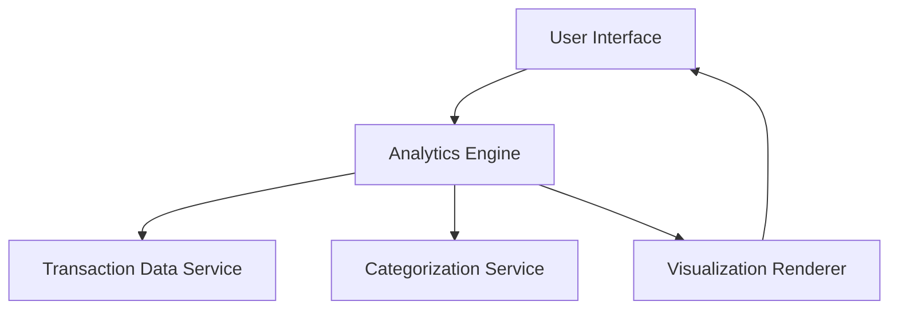

#### 1. High-Level Design

- **Summary:** This epic provides interactive analytics and visualization capabilities for users to understand spending patterns through category-wise analysis across nine predefined categories (Food & Dining, Fuel, Shopping, Travel, Entertainment, Utilities, Healthcare, Education, Miscellaneous). It includes monthly spend trends and card-wise spend analysis to enable data-driven financial decisions.

- **Component Flow:**

- **Integration Points:** 
  - **Upstream:** Transaction data service (for retrieving and categorizing transactions)
  - **Upstream:** Analytics engine (for calculating category-wise and card-wise spending patterns)

- **Key Assumptions:** 
  - Transaction categorization is performed by an existing categorization service with predefined rules
  - Monthly spend trends are calculated based on transaction timestamp and aggregated on a monthly basis

- **NFR Highlights:** Visualizations must render efficiently with large transaction datasets; analytics calculations must be accurate and real-time; charts must be responsive and interactive across all device types

#### 2. Validation Report

- **Requirements Coverage:** The design covers all stated scope including category-wise visualization, monthly trends, card-wise analysis, and interactive charts. The component flow addresses data retrieval, categorization, analytics computation, and visualization rendering. Integration points with transaction and analytics services are clearly identified to support the epic's requirements.