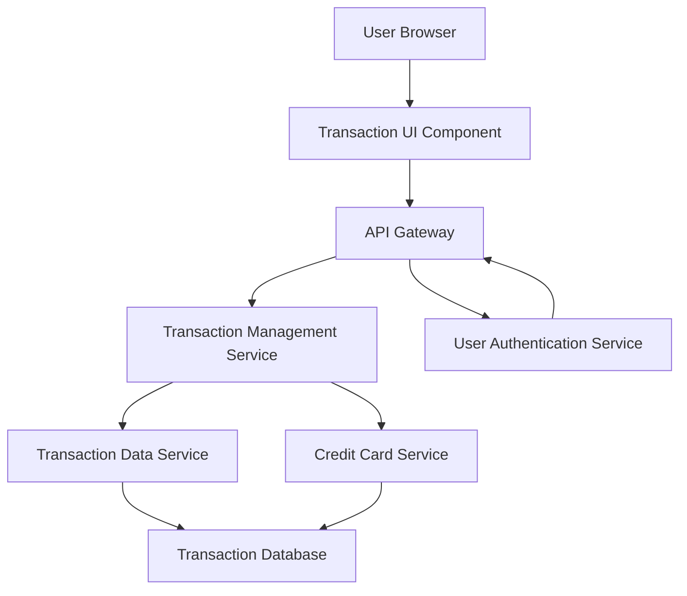

#### 1. High-Level Design

- **Summary:** This epic delivers comprehensive transaction visibility across all credit cards, enabling users to view, search, and analyze transaction history. The core requirement is to provide a unified transaction management system supporting multi-card transaction views, transaction details display, and search/filtering capabilities to track spending activities and verify charges.

- **Component Flow:**

- **Integration Points:**
  - **Upstream:** User Authentication Service (for secure transaction access and user authorization)
  - **Downstream:** Transaction Data Service (retrieves transaction records), Credit Card Service (links transactions to specific credit cards)

- **Key Assumptions:**
  - Transaction data is indexed by user ID, card ID, date, and category to support efficient search and filtering operations.
  - Transaction history retention period is defined by business policy (assumed minimum 24 months for regulatory and user needs).

- **NFR Highlights:** Transaction data must be displayed with minimal latency; system must handle large transaction volumes efficiently; transaction history must be securely stored and retrieved.

- **Data Flow:** User authenticates via User Authentication Service and accesses Transaction UI. User can view all transactions or apply search/filter criteria (date range, card, amount, merchant). Request flows through API Gateway to Transaction Management Service. Service queries Transaction Data Service for transaction records and Credit Card Service to link transactions to specific cards. Transaction Data Service retrieves data from Transaction Database using optimized queries (indexed searches). Results are returned to Transaction Management Service, which consolidates and formats transaction data (including card details, transaction details, merchant information). Data is sent to Transaction UI Component, which renders transaction list with minimal latency, supporting pagination for large volumes.

#### 2. Validation Report

- **Requirements Coverage:** The design fully addresses the epic's scope including Transaction listing, Transaction history view, Multi-card transaction support, Transaction details display, and Transaction search and filtering capabilities. All NFRs are covered: minimal latency through optimized database queries and indexing, efficient handling of large transaction volumes via pagination and indexed searches, and secure storage/retrieval through User Authentication Service integration. Integration dependencies (Transaction Data Service, Credit Card Service, User Authentication Service) are properly incorporated. Out-of-scope items (real bank integration, card payments, fund transfers, transaction disputes, payment gateway integration) are correctly excluded from the design.