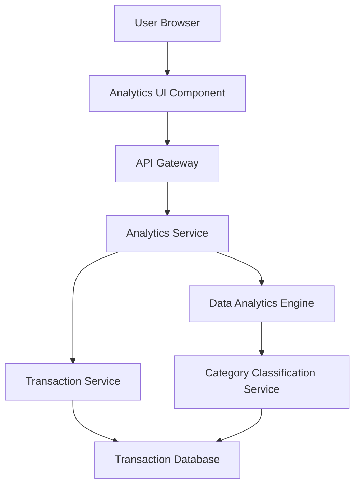

#### 1. High-Level Design

- **Summary:** This epic provides interactive visualizations and analytics to help users understand spending patterns through category-wise analysis and monthly trend tracking. The core requirement is to deliver analytics across 9 predefined categories (Food & Dining, Fuel, Shopping, Travel, Entertainment, Utilities, Healthcare, Education, Miscellaneous) with card-wise breakdowns and monthly trend analysis, enabling data-driven financial decisions.

- **Component Flow:**

- **Integration Points:**
  - **Upstream:** Transaction Service (provides raw transaction data for analysis)
  - **Downstream:** Data Analytics Engine (performs aggregation, calculations, and trend analysis), Category Classification Service (categorizes transactions into predefined categories)

- **Key Assumptions:**
  - Transactions are pre-classified into categories by Category Classification Service, or classification occurs in near real-time.
  - Monthly trend data is calculated using calendar month boundaries; historical data is retained for at least 12 months for trend analysis.

- **NFR Highlights:** Analytics visualizations must render within 2 seconds; system must support interactive filtering and drill-down capabilities; charts must be responsive and accessible across all device types.

- **Data Flow:** User accesses Analytics UI and selects analysis parameters (date range, card, category). Request flows through API Gateway to Analytics Service. Analytics Service retrieves raw transaction data from Transaction Service, which queries Transaction Database. Data Analytics Engine aggregates transactions by category and time period, leveraging Category Classification Service for categorization. Processed analytics data (category-wise spending, monthly trends, card-wise breakdowns) is returned to Analytics Service, formatted as chart-ready data, and sent to UI. Analytics UI Component renders interactive visualizations (charts and graphs) within 2-second performance target.

#### 2. Validation Report

- **Requirements Coverage:** The design comprehensively covers the epic's scope including Category-wise spending visualization, Monthly spend trends analysis, Card-wise spend analysis, Interactive charts and graphs, Spending pattern identification, and Multi-category support for 9 predefined categories. All NFRs are addressed: 2-second rendering performance through optimized Data Analytics Engine, interactive filtering via Analytics Service, and responsive charts through modern UI components. Integration dependencies (Transaction Service, Data Analytics Engine, Category Classification Service) are properly incorporated. Out-of-scope items (real bank integration, predictive analytics, budget alerts, custom categories, export functionality) are correctly excluded.