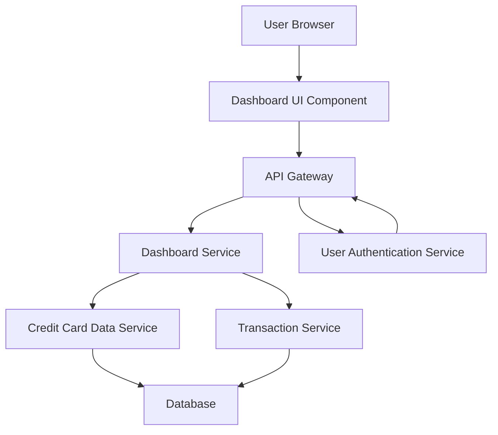

#### 1. High-Level Design

- **Summary:** This epic delivers a consolidated dashboard that aggregates and displays key performance indicators (KPIs) for the user's credit card portfolio. The core requirement is to provide real-time visibility into monthly spend, total credit limit, available credit, and outstanding amounts across multiple credit cards through a responsive interface accessible on desktop, tablet, and mobile devices.

- **Component Flow:**

- **Integration Points:**
  - **Upstream:** User Authentication Service (for secure access and user identity verification)
  - **Downstream:** Credit Card Data Service (retrieves card details, balances, credit limits), Transaction Service (calculates monthly spend from transaction records)

- **Key Assumptions:**
  - KPI data refresh occurs on-demand when dashboard loads or at configurable intervals (e.g., every 30 seconds for real-time updates).
  - Credit card data is pre-aggregated or can be calculated efficiently from underlying services without significant latency.

- **NFR Highlights:** Dashboard must be responsive across desktop, tablet, and mobile devices; real-time data refresh for KPIs; must support concurrent viewing of multiple credit cards without performance degradation.

- **Data Flow:** User authenticates via User Authentication Service. Upon successful authentication, Dashboard UI requests KPI data through API Gateway. Dashboard Service orchestrates calls to Credit Card Data Service (for credit limits, available credit, outstanding amounts) and Transaction Service (for monthly spend calculations). Services query the Database and return aggregated data. Dashboard Service consolidates responses and returns formatted KPI data to the UI, which renders the responsive dashboard with real-time metrics.

#### 2. Validation Report

- **Requirements Coverage:** The design fully covers the epic's stated scope including Dashboard KPIs display, Monthly Spend tracking, Total Credit Limit aggregation, Available Credit calculation, Outstanding Amount display, Multiple credit cards view, and Responsive layout design. All specified NFRs (responsiveness, real-time refresh, concurrent multi-card support) are addressed through the component architecture. Integration dependencies (Credit Card Data Service, Transaction Service, User Authentication Service) are incorporated. Out-of-scope items (real bank integration, payments, fund transfers, loans, payment gateway) are correctly excluded from the design.