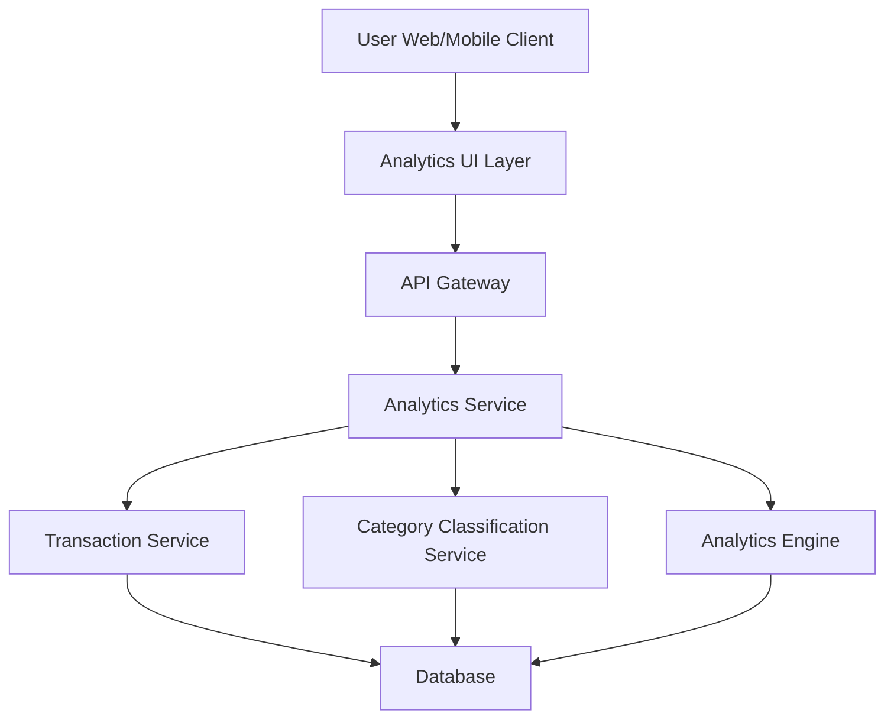

#### 1. High-Level Design

- **Summary:** This epic delivers interactive visualizations and analytics capabilities that enable users to understand their spending patterns across predefined categories (Food & Dining, Fuel, Shopping, Travel, Entertainment, Utilities, Healthcare, Education, Miscellaneous). Users can analyze monthly spend trends, view category-wise breakdowns, and identify spending patterns to make data-driven financial decisions. The system supports historical data analysis for at least 12 months.

- **Component Flow:**

- **Integration Points:**
  - **Upstream:** Transaction Service (provides raw transaction data for analysis)
  - **Upstream:** Category Classification Service (categorizes transactions into predefined spending categories)
  - **Upstream:** Analytics Engine (generates insights, trends, and aggregated spending metrics)
  - **Downstream:** User Web/Mobile Client (renders interactive charts and visualizations)

- **Key Assumptions:**
  - Transactions are automatically categorized by the Category Classification Service using rule-based or ML-based classification; users cannot manually recategorize transactions in this epic.
  - Monthly spend trends are calculated based on calendar months; historical data for 12 months is pre-aggregated or computed on-demand with caching for performance.

- **NFR Highlights:** Analytics visualizations must render within 1 second; support historical data analysis for at least 12 months; charts must be interactive and responsive across all device types.

- **Data Flow:** User accesses the spending analytics interface via web or mobile client. The Analytics UI Layer sends a request through the API Gateway to the Analytics Service. The Analytics Service orchestrates data retrieval by calling the Transaction Service (for raw transaction data), the Category Classification Service (to categorize transactions), and the Analytics Engine (to compute trends, aggregations, and insights). All services query the Database for relevant information. The Analytics Service aggregates the results, formats them for visualization, and returns the data through the API Gateway to the Analytics UI Layer. The UI renders interactive charts and graphs showing category-wise spending breakdowns and monthly trends.

#### 2. Validation Report

- **Requirements Coverage:** The design fully addresses the epic's scope, including category-wise spending visualization, monthly spend trend analysis, interactive charts and graphs, spending pattern identification, multi-category spending breakdown, and transaction categorization. All NFRs are met: visualizations render within 1 second through optimized data aggregation and caching, 12-month historical data support is ensured via the Analytics Engine, and interactive responsive charts are delivered through the Analytics UI Layer. The design delivers the stated user value by enabling actionable insights into spending behavior and supporting informed budgeting decisions through comprehensive analytics capabilities.