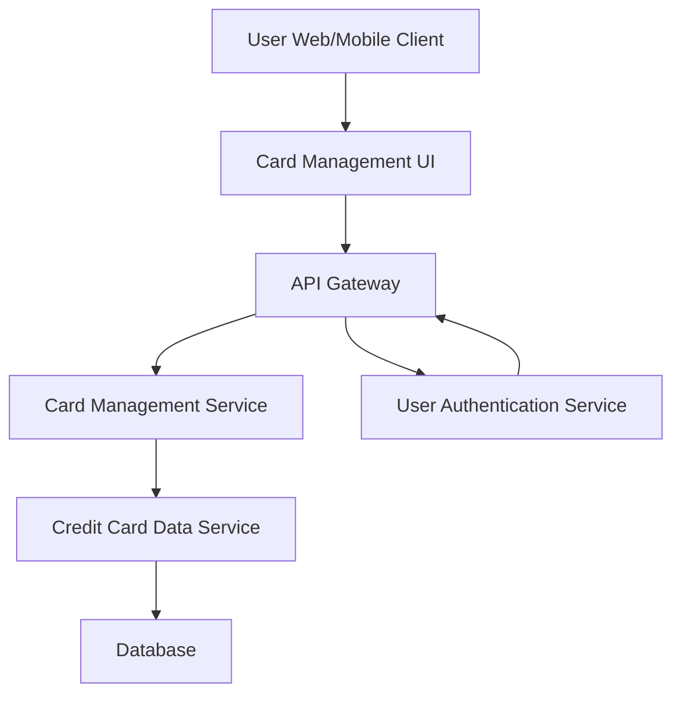

#### 1. High-Level Design

- **Summary:** This epic enables users to view and manage multiple credit cards within a single consolidated interface. Users can see all their credit cards with relevant details, monitor card-specific information, and compare different cards simultaneously. The feature supports up to 50 credit cards per user with secure display (masked card numbers) and fast retrieval.

- **Component Flow:**

- **Integration Points:**
  - **Upstream:** Credit Card Data Service (retrieves card information, details, and balances)
  - **Upstream:** User Authentication Service (ensures secure access control and user identity verification)
  - **Downstream:** User Web/Mobile Client (displays multiple cards in consolidated interface)

- **Key Assumptions:**
  - Card data is stored in a normalized format with masked card numbers for display; full card numbers are never transmitted to the client.
  - Card-wise spend analysis aggregates transaction data per card; the system assumes each transaction is tagged with a card identifier.

- **NFR Highlights:** System must support display of up to 50 credit cards per user; card data retrieval latency under 300ms; secure storage and display with masked card numbers.

- **Data Flow:** User authenticates and accesses the card management interface via web or mobile client. The Card Management UI sends a request through the API Gateway, which first validates the user's identity via the User Authentication Service. Upon successful authentication, the request is routed to the Card Management Service, which calls the Credit Card Data Service to retrieve all cards associated with the user. The Credit Card Data Service queries the Database and returns card details with masked card numbers. The Card Management Service aggregates and formats the data, then sends it back through the API Gateway to the UI for display in a consolidated list view.

#### 2. Validation Report

- **Requirements Coverage:** The design comprehensively covers the epic's scope, including multiple credit card display, card details view, card-wise spend analysis, credit card list management, and individual card information display. All NFRs are addressed: support for up to 50 cards per user, sub-300ms latency through optimized service calls, and secure storage/display with masked card numbers enforced at the service layer. The design delivers the user value by providing a unified view of all credit cards, eliminating the need for multiple banking portals and simplifying credit card management.